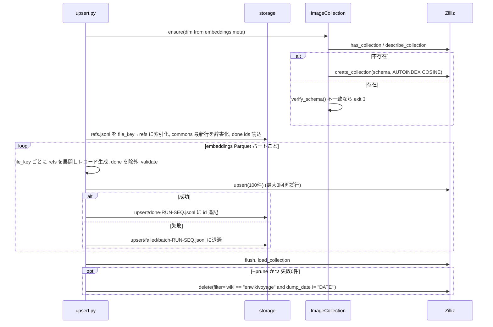
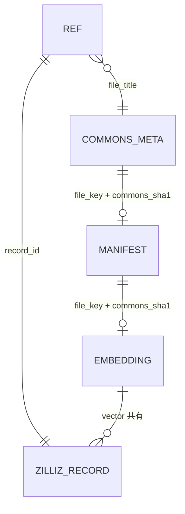

# Wikivoyage 画像埋め込みパイプライン（SigLIP2 → Zilliz `wikivoyage_images`）— 設計書

- Status: Draft
- Date: 2026-11-13
- Source requirement: `design/specification.md` — 英語 Wikivoyage 現行版ダンプから記事内の全画像参照を抽出し、Wikimedia Commons API で URL・ライセンス等を取得、サムネイルをダウンロード・前処理して `google/siglip2-so400m-patch16-384` で埋め込み、Zilliz Cloud の新コレクション `wikivoyage_images` に登録する。

---

## 1. 概要

既存リポジトリは Wikivoyage 記事テキストを BGE-M3 で埋め込み `wikivoyage_pages` に登録する RAG パイプラインを持つ。本設計はこれと並列に、**記事に掲載された画像** を SigLIP2 で埋め込み、新コレクション `wikivoyage_images` に「記事×画像」単位で登録する画像パイプラインを追加する。目的は画像類似検索・テキスト→画像検索（SigLIP2 テキストエンコーダ）・記事で絞り込んだビジュアル検索の基盤を作ること。利用者はリポジトリ所有者（開発者）であり、検索は当面 CLI／Python API として提供する。全ステージは独立に再実行・再開でき、同一ダンプ・同一画像の再実行で再計算・重複登録が起きない（冪等）ことを設計の中心に置く。

## 2. スコープ

### In scope
- ダンプ取得（日付指定、Range による再開、`dumpstatus.json` の SHA1 による検証、User-Agent 送信）
- 既存 `wikivoyage_stream/` を使ったストリーム解析と ns=0／非リダイレクト／非空ページのフィルタ
- wikitext からの画像参照抽出（`[[File:]]`/`[[Image:]]`、`<gallery>`、テンプレート引数（pagebanner・listing の `image=`・Infobox 等））
- Commons `imageinfo` API によるメタデータ取得（50 件/リクエスト、`continue` 対応、指数バックオフ、`maxlag`）
- サムネイル（幅 768px）のダウンロード・検証・前処理（RGB 化、透過の白背景合成、極端なアスペクト比のパディング）
- SigLIP2 画像埋め込み（L2 正規化、float32、バッチ、cuda/mps/cpu 自動選択、モデルリビジョン記録）
- Zilliz コレクション `wikivoyage_images` の作成・スキーマ互換性検証・100 件バッチ upsert・失敗バッチ退避と再投入
- 検索モジュールと CLI（画像ファイル／画像 URL／テキスト、`page_title` フィルタ）
- ローカルディスクまたは S3 を作業領域とする中間ファイル群、ステージ別ログ・実行サマリ
- AWS Batch（Fargate）用 Dockerfile・ジョブ定義（取得系ステージ用）

### Out of scope
- `chatbot/`（HF Spaces）への画像検索エンドポイント・UI の組み込み（別仕様。§12 参照）
- 日本語版 Wikivoyage・Wikipedia 等への展開（設計上の拡張点 `wiki` フィールド・設定化のみ用意）
- GPU 付き AWS Batch（EC2 GPU コンピュート環境）の構築。埋め込みはローカル（mps/cuda）または手動起動の GPU マシンで実行する
- 画像のキャプション生成・OCR・重複画像（知覚ハッシュ）検出
- 既存 `wikivoyage_pages` コレクション・既存ステージ 1〜3 の挙動変更（共通関数の移設を除く）
- 動画・音声・PDF・GIF・TIFF（既定で除外。TIFF は設定で許可可能）

## 3. 機能要件

| ID | 要件 | 優先度 |
|---|---|---|
| FR-01 | ダンプ日付 `YYYYMMDD` を指定して `enwikivoyage-<date>-pages-articles.xml.bz2` を取得する。既存かつ検証済みなら再ダウンロードしない | Must |
| FR-02 | ダウンロード中断時は `.part` ファイルから HTTP Range で再開する | Must |
| FR-03 | `https://dumps.wikimedia.org/enwikivoyage/<date>/dumpstatus.json` の SHA1（無ければ `<date>-sha1sums.txt`、次に md5sums）で検証し、不一致時は削除して終了コード 2 で停止 | Must |
| FR-04 | ダンプ・API・画像取得の全 HTTP リクエストで識別可能な User-Agent（`WIKIVOYAGE_USER_AGENT`）を送る。ダンプは同時接続 1 | Must |
| FR-05 | ダンプをストリーム解析し、ns=0・非リダイレクト・本文非空のページのみ処理する（全体をメモリに載せない） | Must |
| FR-06 | wikitext から全画像参照を抽出し、`file_title`（`File:` 正規化）、`caption`、`position`、`context`、`source_page_id`、`source_page_title` を出力する | Must |
| FR-07 | 同一記事内は `file_title` で重複排除し、出現順上位 `IMAGES_MAX_PER_PAGE`（既定 50）件に制限する | Must |
| FR-08 | 画像参照のない記事はスキップし、抽出失敗は該当参照のみスキップする | Must |
| FR-09 | 抽出結果を JSONL（`refs.jsonl`）に保存する | Must |
| FR-10 | ユニーク `file_title` を 50 件ずつ Commons API に照会し、URL・サイズ・MIME・SHA1・extmetadata を取得する | Must |
| FR-11 | Commons で `missing` の場合は `en.wikivoyage.org` の API にフォールバック照会する（ローカルアップロード画像対策） | Should |
| FR-12 | 許可 MIME（jpeg/png/webp/svg+xml）以外は `skipped` として記録する。SVG は Commons がレンダリングした PNG サムネイルを使う | Must |
| FR-13 | API 失敗時は指数バックオフで再試行し、`maxlag`・429・503 の `Retry-After` を尊重する。同時実行数は既定 2 | Must |
| FR-14 | サムネイルを `sha1(file_title)` ベースのパスに保存し、既存かつ Commons SHA1 が同一なら再ダウンロードしない | Must |
| FR-15 | ダウンロード結果（成功・失敗・スキップ、理由、バイト数、内容 SHA-256、取得日時）を記録する | Must |
| FR-16 | 0 バイト・非画像 Content-Type（HTML エラーページ等）・破損・100px 未満・8192px 超・アニメーション画像を除外する | Must |
| FR-17 | 前処理：RGB 化、透過は白背景合成、アスペクト比 ≥ 2.0 は白で正方形パディング。処理済み画像を raw と別ディレクトリに保存 | Must |
| FR-18 | SigLIP2 で画像埋め込みを計算し、L2 正規化した float32 を保存する。バッチ処理、cuda→mps→cpu の自動選択 | Must |
| FR-19 | 埋め込みは `(file_key, commons_sha1, model_id, model_revision)` 単位でキャッシュし、再計算しない | Must |
| FR-20 | バッチ失敗時は 1 枚ずつ再試行して失敗画像のみスキップする | Must |
| FR-21 | モデル ID・解決済みリビジョン（commit hash）・transformers/torch バージョン・次元を記録する | Must |
| FR-22 | コレクションが無い場合のみ作成（次元はモデルから取得、COSINE、AUTOINDEX、動的フィールド無効）。存在する場合はスキーマ互換性を検証し、不一致なら終了コード 3 で停止 | Must |
| FR-23 | 「記事×画像」1 組を 1 レコードとし、決定的 `id` で upsert する（再実行で重複しない） | Must |
| FR-24 | upsert 前に必須項目・次元・型・VARCHAR バイト長を検証し、100 件バッチで登録、件数と処理時間を記録する | Must |
| FR-25 | 失敗バッチを JSONL に退避し、`replay` サブコマンドで再投入できる | Must |
| FR-26 | 中断後の再実行で、完了済みの API 照会・ダウンロード・埋め込み・upsert を飛ばして再開する | Must |
| FR-27 | ライセンス情報（license, license_url, artist, credit, image_page_url, page_id, page_title, dump_date）を Zilliz と監査 JSONL の両方に保存する | Must |
| FR-28 | 検索：画像ファイル・画像 URL・テキストで検索し、`page_title` で絞り込める。結果に page_title, page_url, image_url, image_page_url, caption, license, license_url, artist, score を返す | Must |
| FR-29 | `--prune` 指定時、当該ダンプで upsert が全件成功した後に `dump_date != <当該日付>` のレコードを削除する（記事から外れた画像の掃除） | Should |
| FR-30 | `status` サブコマンドで各ステージの件数・未処理数・失敗数を表示する | Should |
| FR-31 | ページ種別フィルタ `IMAGES_PAGE_TYPES`（既定 `*`＝全記事） | Could |
| FR-32 | TIFF を許可 MIME に追加可能にする（Commons の JPEG サムネイルを使用） | Could |

### 主要ユースケースフロー

**UC-1 初回フル実行（正常系）**
1. `python -m image_embedding dump --dump-date 20261101` → ダンプ取得・SHA1 検証。
2. `python -m image_embedding extract --dump-date 20261101` → `runs/20261101/refs.jsonl`。
3. `python -m image_embedding commons --dump-date 20261101` → `runs/20261101/commons/part-*.jsonl`。
4. `python -m image_embedding fetch --dump-date 20261101` → `images/raw|processed/...`、`images/manifest/part-*.jsonl`。
5. `python -m image_embedding embed --dump-date 20261101` → `embeddings/<model_slug>/part-*.parquet`。
6. `python -m image_embedding upsert --dump-date 20261101` → Zilliz 登録、`runs/20261101/upsert/done-*.jsonl`。
（`all` サブコマンドは 1〜6 を順に実行する。）

**UC-2 中断からの再開**：任意ステージを同じ引数で再実行すると、完了済みキー（下記 §6.3）を読み込んで未処理分だけ処理する。

**UC-3 次回ダンプでの差分更新**：新しい日付で 1〜6 を実行。画像ファイル・埋め込みはダンプ横断で共有キャッシュされるため、新規／更新画像のみダウンロード・埋め込みされる。upsert は全レコードを新 `dump_date` で再登録（ベクトルはキャッシュから）し、`--prune` で消えた参照を削除する。

**エラー系**
- E-1 ダンプ URL 404 → 終了コード 1、URL と日付をログ出力（FR-01）。
- E-2 SHA1 不一致 → `.bz2` 削除、終了コード 2、「再実行してください」とログ（FR-03）。
- E-3 Commons 5xx/タイムアウト → 最大 6 回指数バックオフ、それでも失敗したタイトルは `status=error` 記録、次回実行で再試行（FR-13, FR-26）。
- E-4 画像 404/破損/小さすぎ → manifest に `failed`/`skipped` と理由を記録し続行（FR-15, FR-16）。
- E-5 埋め込み OOM/例外 → 1 枚ずつ再試行、失敗画像を `embeddings/<slug>/errors/part-*.jsonl` に記録（FR-20）。
- E-6 Zilliz upsert 失敗（3 回再試行後）→ `runs/<date>/upsert/failed/batch-*.jsonl` に退避し続行。`replay` で再投入（FR-25）。
- E-7 スキーマ不一致 → 差分を表示し終了コード 3。データには一切書き込まない（FR-22）。

## 4. 非機能要件

| 項目 | 要件・値 |
|---|---|
| データ規模（見積り） | 対象記事 約 3.3 万、画像参照 約 20〜35 万、ユニーク画像 約 15〜25 万（実測値で §12 を更新） |
| メモリ | extract：ダンプストリーム処理でピーク 1 GB 未満。upsert：参照インデックス（`file_key → refs`）とメタデータ辞書で 1.5 GB 未満。埋め込みベクトルを全件メモリに載せない（Parquet をパート単位で読む） |
| 処理時間目安 | commons：約 5,000 リクエスト × 約 1 req/s ≈ 1.5 h。fetch：25 万枚 / 4 req/s ≈ 17 h（再開可能）。embed：Apple M シリーズ mps で 3〜8 枚/s ≈ 9〜24 h、CUDA GPU（L4 等）で 1〜2 h。upsert：数十分 |
| ストレージ | raw サムネイル平均 ~120 KB、processed JPEG（q=95）平均 ~120 KB → 合計 ~60 GB 上限見込み。埋め込み 1152 × 4 B ≈ 4.6 KB/枚 → ~1.2 GB |
| レート制限 | ダンプ：同時 1 接続。Commons API：同時 2（`IMAGES_API_CONCURRENCY`、最大 4）、`maxlag=5`。画像：同時 3（`IMAGES_DOWNLOAD_CONCURRENCY`）＋グローバル 4 req/s（`IMAGES_DOWNLOAD_RPS`）。429/503 は `Retry-After` 秒待機 |
| 冪等性 | 全ステージの成果物はキー単位で「完了済みなら skip」。Zilliz は決定的 `id` に対する upsert |
| 可用性・再開 | 各ステージ独立に再実行可能。進捗は 1,000 件（`IMAGES_FLUSH_EVERY`）ごとにパートファイルとして確定し、クラッシュ時の損失は最大 1,000 件分の再処理 |
| セキュリティ | `ZILLIZ_URI`/`ZILLIZ_TOKEN`/`HF_TOKEN`/AWS 認証はすべて環境変数（`.env` は既存方式で読み込み）。コードにハードコードしない。画像 URL 検索は http/https のみ、レスポンス 20 MB 上限、Pillow の decompression bomb 保護有効 |
| 可観測性 | 標準ログ（既存と同形式 `%(asctime)s %(levelname)s %(name)s: %(message)s`、logger 名 `wikivoyage.images.<stage>`）に加え、ステージごとに `runs/<date>/summary/<stage>-<run_id>.json`（開始/終了時刻、入力件数、成功/失敗/スキップ件数、所要時間、モデル情報） |
| 監査性・再現性 | 各 Zilliz レコードは `dump_date`・`page_id`・`revision_id`・`image_title`・`commons_sha1`・`embedding_model`・`embedding_revision` を持ち、JSONL から辿れる |
| コスト | Zilliz Serverless/Free tier を想定。1152 次元 × 35 万レコード ≈ 1.6 GB ベクトル。Fargate 2 vCPU/4 GB で fetch 約 17 h ≈ 数ドル |
| 拡張性 | `wiki`（既定 `enwikivoyage`）・サイトベース URL・API エンドポイントを設定化。`id` の入力に `wiki` を含めるため、他 wiki のレコードと衝突しない |

## 5. アーキテクチャ

### 5.1 コンポーネント

新規パッケージ `image_embedding/` を追加し、既存パッケージは最小限の変更で再利用する。

| モジュール | 責務 | 既存部品の再利用 |
|---|---|---|
| `image_embedding/__main__.py` | argparse サブコマンド（`dump` `extract` `commons` `fetch` `embed` `upsert` `replay` `search` `status` `all`）。`.env` 読み込み、ロギング初期化 | `load_dotenv(<repo root>/.env)` 方式（`embedding/upsert_zilliz.py` と同じ。既存環境変数を上書きしない） |
| `image_embedding/config.py` | 環境変数・CLI 引数を `ImagesConfig` dataclass に集約 | — |
| `image_embedding/storage.py` | 作業領域抽象。`LocalStore` / `S3Store`（`exists` `read_bytes` `write_bytes_atomic` `list(prefix)` `iter_jsonl_parts` `write_jsonl_part`） | S3 URI 解析は `get_wikivoyage._parse_s3_bucket` と同じ形式（`bucket` / `s3://bucket/prefix`） |
| `image_embedding/http.py` | 共通 `requests.Session`（User-Agent、タイムアウト、リトライ、トークンバケット型レートリミッタ、`Retry-After` 処理） | `wikivoyage_stream.reader.DEFAULT_USER_AGENT` と `WIKIVOYAGE_USER_AGENT` |
| `image_embedding/dump.py` | ダンプ URL 組み立て、Range 再開ダウンロード、`dumpstatus.json` による SHA1 検証 | — |
| `image_embedding/extract.py` | ダンプをストリームし、ページフィルタ後に画像参照抽出、`refs.jsonl` 出力 | `wikivoyage_stream.WikivoyageDumpStreamReader`、`wikivoyage_stream.filters`（新設、下記） |
| `image_embedding/wikitext_images.py` | wikitext → `ImageRef` リスト（リンク・ギャラリー・テンプレート引数、キャプション、コンテキスト、正規化、重複排除、上限） | `mwparserfromhell`（既存依存） |
| `image_embedding/commons.py` | Commons/Wikivoyage `imageinfo` 照会、extmetadata の整形（HTML→テキスト）、MIME 判定 | `http.py` |
| `image_embedding/fetch.py` | サムネイルのダウンロード・検証・前処理、manifest 出力 | `http.py`, `preprocess.py`, `storage.py` |
| `image_embedding/preprocess.py` | Pillow による検証・RGB 化・白背景合成・パディング | — |
| `image_embedding/embedder.py` | `SiglipImageEmbedder`（画像・テキスト両エンコーダ、デバイス選択、L2 正規化、メタ情報） | 構造は `embedding/embedder.py` の `Embedder` に倣う |
| `image_embedding/embed.py` | 埋め込みステージ（未処理抽出、バッチ、Parquet パート出力） | Parquet パート出力は `scripts/embed_chunks.py` と同様の list<float32> 形式 |
| `image_embedding/zilliz.py` | `ImageCollection`：スキーマ定義・作成・互換性検証・レコード検証・バッチ upsert・prune | `embedding/upserter.Upserter`（`upsert` `flush` `load_collection` `get_collection_stats` を委譲）、`pymilvus.MilvusClient(uri=ZILLIZ_URI, token=ZILLIZ_TOKEN)` |
| `image_embedding/upsert.py` | refs × metadata × embeddings を結合してレコード化、upsert ステージ・replay | — |
| `image_embedding/search.py` | `ImageSearcher`（画像／画像 URL／テキスト、フィルタ） | `embedder.py` |
| `image_embedding/ids.py` | `file_key`・`record_id`・`model_slug` の計算 | — |
| `wikivoyage_stream/filters.py`（新設） | `is_redirect(text)`、`page_url(title)`、`is_article(page)` を共通化 | `get_wikivoyage._is_redirect` と URL 生成ロジックを移設し、`get_wikivoyage.py` からはこれを import（挙動不変） |

**使わないもの**：`wikivoyage_pipeline/`、`pipeline.py`、`embedding/upsert_zilliz.py` の `_create_collection()`/`_embed_batch()`（いずれもデッドコード）。

### 5.2 メインフロー

```mermaid
flowchart TD
    A[dumps.wikimedia.org<br/>enwikivoyage-DATE-pages-articles.xml.bz2] -->|dump: Range再開 + SHA1検証| B[(dumps/DATE/*.xml.bz2)]
    B -->|extract: WikivoyageDumpStreamReader<br/>ns=0 / 非redirect / 非空| C[wikitext_images.extract_refs]
    C --> D[(runs/DATE/refs.jsonl)]
    D -->|commons: ユニークfile_title 50件/req| E[commons.wikimedia.org/w/api.php<br/>fallback: en.wikivoyage.org/w/api.php]
    E --> F[(runs/DATE/commons/part-*.jsonl)]
    F -->|fetch: thumburl 768px, 同時3, 4req/s| G[upload.wikimedia.org]
    G --> H[(images/raw/xx/KEY.ext)]
    H -->|preprocess| I[(images/processed/xx/KEY.jpg)]
    G --> J[(images/manifest/part-*.jsonl)]
    I -->|embed: SigLIP2 get_image_features + L2| K[(embeddings/MODEL_SLUG/part-*.parquet)]
    D & F & J & K -->|upsert: join, 検証, 100件バッチ| L[(Zilliz wikivoyage_images)]
    L --> M[search: 画像 / 画像URL / テキスト(SigLIP2 text) + page_titleフィルタ]
```

### 5.3 upsert シーケンス



### 5.4 既存コードへの変更

| ファイル | 変更 |
|---|---|
| `wikivoyage_stream/filters.py` | 新設（`is_redirect`, `page_url`, `is_article`）。`page_url` は `get_wikivoyage.build_record` と同じ `quote(title.replace(" ", "_"), safe="_()',-")` |
| `get_wikivoyage.py` | `_is_redirect` と URL 生成を `wikivoyage_stream.filters` 呼び出しに置換（`_is_redirect = filters.is_redirect` の別名を残し挙動不変） |
| `wikivoyage_stream/models.py`, `parser.py` | `Page.redirect_title: Optional[str] = None` を追加し、`<redirect title="…"/>` 要素を読む（既存呼び出し側は影響なし）。`is_article` は `redirect_title` と `#REDIRECT` テキスト判定の両方を見る |
| `.env.example` | §7.4 の画像系変数を追記 |
| `.gitignore` | `images_work/` を追加 |
| `Dockerfile.images`（新設、ルート） | ビルドコンテキストはリポジトリルート（`wikivoyage_stream/` を含めるため）。`python:3.11-slim`、`image_embedding/requirements.txt` のみ（torch なし）、`ENTRYPOINT ["python", "-m", "image_embedding"]`、非 root ユーザ |
| `image_embedding/requirements.txt` | `requests>=2.31`, `mwparserfromhell>=0.6.6`, `boto3>=1.28`, `pyarrow>=14.0`, `Pillow>=10.3`, `pymilvus>=2.5`, `python-dotenv>=1.0` |
| `image_embedding/requirements-embed.txt` | `-r requirements.txt` + `torch>=2.3`, `transformers>=4.49,<6`, `sentencepiece>=0.2`, `protobuf>=4` |
| `requirements_all.txt` | `-r image_embedding/requirements-embed.txt` を追記 |
| `scripts/publish_ecr.sh` | `DOCKERFILE`（既定 `Dockerfile`）環境変数を追加し `docker build -f "$DOCKERFILE"` に。画像系は `DOCKERFILE=Dockerfile.images REPO_NAME=wikivoyage-images` |
| `infra/batch_job_definition_images.json`（新設） | `wikivoyage-images-fargate`、2 vCPU / 4096 MB、`ephemeralStorage` 50 GiB、`command` は `["extract","--dump-date","Ref::dump_date"]` 等をジョブ投入時に上書き |
| `infra/cloudformation-batch.yml` | `ImagesJobDefinition` リソースと、タスクロールへ画像用 S3 プレフィックス（`images_work/*`）の Get/Put/List 権限を追加 |
| `CLAUDE.md` / `README.md` | 画像パイプラインのコマンドと環境変数を追記 |

**実行場所**：`dump`/`extract`/`commons`/`fetch` は Fargate（CPU・ネットワーク主体）またはローカル。`embed` はローカル（mps/cuda）か GPU マシン（Fargate は GPU 非対応のため）。`upsert`/`search` はどこでも可。ステージ間は `IMAGES_WORKDIR`（ローカルパスまたは `s3://…`）で受け渡す。

## 6. データモデル

### 6.1 識別子

| 名前 | 定義 | 用途 |
|---|---|---|
| `file_title` | 正規化済み `File:<Name>`（§8.1 の規則） | Commons 照会キー |
| `file_key` | `sha1(file_title.encode("utf-8")).hexdigest()`（40 桁小文字 hex） | 画像ファイル名、ダウンロード／埋め込みキャッシュのキー（要件 3.5「`File:` タイトルの SHA-1 ベース」） |
| `commons_sha1` | Commons `imageinfo.sha1`（元ファイル内容の SHA-1） | 再アップロード検出。値が変わったら再ダウンロード・再埋め込み |
| `record_id` | `int.from_bytes(sha1(f"{wiki}\|{page_id}\|{file_title}".encode()).digest()[:8], "big") & 0x7FFF_FFFF_FFFF_FFFF`（正の INT64） | Zilliz 主キー。dump_date・position・モデルに依存しない決定的 ID なので再実行・次ダンプで同じ行が上書きされる |
| `model_slug` | `model_id` の `/` を `__` に置換 + `@` + revision 先頭 12 桁（例 `google__siglip2-so400m-patch16-384@a1b2c3d4e5f6`） | 埋め込みディレクトリ名 |
| `run_id` | `YYYYMMDDTHHMMSSZ-<4桁乱数hex>` | パートファイル名・サマリ |

63 bit ハッシュの衝突確率は 35 万件で約 7×10⁻⁹ と無視でき、upsert 前に同一バッチ・同一 run 内での重複 `record_id` を検出したら（異なる `(page_id, file_title)` なら）エラーログを出しスキップする。

### 6.2 作業領域のディレクトリ構成（`IMAGES_WORKDIR`、既定 `images_work/`）

```
images_work/
  dumps/<date>/enwikivoyage-<date>-pages-articles.xml.bz2      # .part（DL中）, .verified（SHA1検証済みマーカー）
  runs/<date>/
    refs.jsonl                         # extract 出力（一時名に書いて rename／S3 は完了後 put）
    extract_errors.jsonl
    commons/part-<run_id>-<seq>.jsonl  # commons 出力（file_title 単位、last-wins）
    upsert/done-<run_id>-<seq>.jsonl   # upsert 済み record_id
    upsert/failed/batch-<run_id>-<seq>.jsonl   # 退避バッチ（完全なレコード、ベクトル込み）
    upsert/replayed/…                  # replay 成功後に移動
    summary/<stage>-<run_id>.json
  images/                              # ダンプ横断で共有
    raw/<key[0:2]>/<file_key>.<ext>    # サムネイル原本（ext は thumburl の拡張子）
    processed/<key[0:2]>/<file_key>.jpg  # 前処理済み RGB JPEG q=95
    manifest/part-<run_id>-<seq>.jsonl
  embeddings/<model_slug>/             # ダンプ横断で共有
    part-<run_id>-<seq>.parquet
    errors/part-<run_id>-<seq>.jsonl
    model_info.json
```

「パートファイル追記＋読み出し時に last-wins でマージ」をすべての進捗記録に使う。ローカルでも S3 でも追記不要で、クラッシュ時は未確定パートが残らない（一時名→rename、S3 は 1 オブジェクト put）。

### 6.3 中間ファイルのスキーマ

**`refs.jsonl`（1 行 = 記事内の 1 画像参照）**

| フィールド | 型 | 説明 |
|---|---|---|
| `wiki` | str | `enwikivoyage` |
| `dump_date` | str | `20261101` |
| `source_page_id` | int | |
| `source_page_title` | str | |
| `page_url` | str | `filters.page_url(title)` |
| `revision_id` | int\|null | |
| `revision_timestamp` | str\|null | ISO 8601 |
| `file_title` | str | 正規化済み `File:…` |
| `file_key` | str | |
| `record_id` | int | |
| `position` | int | 記事内の出現順（重複排除後、1 始まり） |
| `caption` | str\|null | プレーンテキスト化、最大 1,000 文字 |
| `context` | str | 参照位置の前後各 200 文字の wikitext |
| `source_kind` | str | `link` \| `gallery` \| `template` |
| `template_name` | str\|null | 例 `pagebanner`, `see` |
| `param_name` | str\|null | 例 `image` |

**`commons/part-*.jsonl`（1 行 = 1 file_title、完了キー＝`file_title`、`status in {ok, missing, skipped}` は完了、`error` は次回再試行）**

| フィールド | 型 | 説明 |
|---|---|---|
| `file_title`, `file_key` | str | 入力キー（API の `normalized` で変わった場合は `canonical_title` に記録） |
| `canonical_title` | str | API が返した正規タイトル |
| `status` | str | `ok` / `missing` / `skipped` / `error` |
| `reason` | str\|null | 例 `mime_not_allowed:image/gif`, `http_503` |
| `repository` | str | `commons` / `local`（FR-11） |
| `thumb_url`, `thumb_width`, `thumb_height`, `thumb_mime` | | `iiurlwidth=768` の結果（SVG は PNG） |
| `original_url`, `width`, `height`, `mime`, `size`, `commons_sha1`, `upload_timestamp` | | |
| `description_url` | str | Commons ファイルページ |
| `license_short_name`, `license_url`, `usage_terms`, `attribution_required` | | extmetadata |
| `artist_html`, `artist`, `credit_html`, `credit`, `image_description` | | `*_html` は原文、無印はタグ除去・空白正規化済み |
| `date_time_original` | str\|null | |
| `fetched_at` | str | ISO 8601 |

**`images/manifest/part-*.jsonl`（完了キー＝`(file_key, commons_sha1)`、`status in {ok, skipped}` は完了、`failed` は `IMAGES_FETCH_MAX_ATTEMPTS`（既定 3）回まで次回再試行）**

`file_key`, `file_title`, `commons_sha1`, `status`（`ok`/`failed`/`skipped`）, `reason`（`http_404`, `content_type:text/html`, `zero_bytes`, `corrupt`, `too_small:80x60`, `too_large`, `animated`）, `attempts`, `source_url`, `raw_path`, `processed_path`, `bytes`, `sha256`（raw 内容）, `http_content_type`, `raw_width`, `raw_height`, `processed_width`, `processed_height`, `preprocess_ops`（例 `["rgba_on_white","pad_square"]`）, `fetched_at`

**`embeddings/<model_slug>/part-*.parquet`（完了キー＝`(file_key, commons_sha1)`）**

| 列 | Arrow 型 |
|---|---|
| `file_key` | string |
| `file_title` | string |
| `commons_sha1` | string |
| `processed_sha256` | string |
| `vector` | list<float32>（長さ = dim、L2 正規化済み） |
| `model_id`, `model_revision` | string |
| `embedded_at` | timestamp[ms, UTC] |

ベクトルは JSONL ではなく Parquet とする（JSON 化で約 3 倍に膨らみ、float32 の精度表現も不安定なため。既存 `scripts/embed_chunks.py` と同じ方式）。

**`model_info.json`**：`model_id`, `model_revision`（解決済み commit hash）, `dim`, `transformers_version`, `torch_version`, `device`, `dtype`, `image_size`（384）, `created_at`。

### 6.4 Zilliz コレクション `wikivoyage_images`

要件 3.8 に、8 章で要求される `license_url` と、監査・拡張用のフィールドを追加する。`enable_dynamic_field=False`、主キー `id`（`auto_id=False`）。VARCHAR の `max_length` は UTF-8 バイト数で、超過分は文字境界で切り詰める（切り詰めは警告ログ）。

| フィールド | 型 | 制約 | 内容 | 要件書との差 |
|---|---|---|---|---|
| `id` | INT64 | PK | `record_id` | |
| `vector` | FLOAT_VECTOR | dim = モデル出力（1152 を想定、実行時取得） | SigLIP2 画像埋め込み | |
| `wiki` | VARCHAR(32) | | `enwikivoyage` | 追加（拡張性） |
| `page_id` | INT64 | | | |
| `page_title` | VARCHAR(512) | | | |
| `page_url` | VARCHAR(2048) | | | |
| `revision_id` | INT64 | nullable | | 追加（監査） |
| `image_title` | VARCHAR(1024) | | `File:…` | |
| `image_url` | VARCHAR(2048) | | `thumb_url`（表示・ダウンロード用） | |
| `original_url` | VARCHAR(2048) | nullable | Commons 原寸 URL | 追加（3.4「オリジナルURLも保存」） |
| `image_page_url` | VARCHAR(2048) | | `description_url` | |
| `caption` | VARCHAR(2048) | nullable | | |
| `position` | INT64 | | 記事内出現順 | 追加 |
| `license` | VARCHAR(256) | | `license_short_name`。取得できない場合は `"unknown"` | |
| `license_url` | VARCHAR(1024) | nullable | | 追加（8 章との矛盾解消） |
| `artist` | VARCHAR(1024) | nullable | タグ除去済み | |
| `credit` | VARCHAR(2048) | nullable | タグ除去済み | |
| `mime_type` | VARCHAR(64) | | 元ファイルの MIME（例 `image/svg+xml`） | |
| `width`, `height` | INT64 | nullable | 元画像サイズ | |
| `file_key` | VARCHAR(40) | | | 追加（キャッシュ・監査） |
| `commons_sha1` | VARCHAR(40) | nullable | | 追加（監査） |
| `dump_date` | VARCHAR(16) | | | |
| `embedding_model` | VARCHAR(128) | | `google/siglip2-so400m-patch16-384` | |
| `embedding_revision` | VARCHAR(64) | | commit hash | 追加（再現性） |
| `created_at` | INT64 | | upsert 時のエポックミリ秒（upsert は行全体を置換するため「最終登録時刻」の意味になる） | 意味を明確化 |

インデックス：`vector` に `AUTOINDEX` / `COSINE`。スカラー `page_title`・`page_id`・`dump_date` に `INVERTED`（フィルタ検索・prune 用）。

**スキーマ互換性検証（`ImageCollection.verify_schema`）**：`describe_collection` の結果と期待スキーマを比較し、(1) 主キー名・型・auto_id、(2) 各フィールドの存在と型、(3) `vector` の dim、(4) VARCHAR の max_length（既存が期待以上なら可）、(5) `enable_dynamic_field`、(6) `vector` インデックスの metric_type＝COSINE を確認。不足・型違い・dim 違いはエラー、既存側の余分な nullable フィールドは警告のみ。



ストレージ選択：中間ファイルは既存方針（JSONL、S3 対応）に合わせ、ベクトルのみ Parquet。画像は「ローカルディスクまたは S3」を `IMAGES_WORKDIR` 一つで切り替える。Zilliz は既存と同じクラスタ・認証を使い、コレクションのみ分ける。

## 7. インターフェース

### 7.1 CLI（`python -m image_embedding <subcommand>`、リポジトリルートで実行）

共通オプション：`--dump-date YYYYMMDD`（env `IMAGES_DUMP_DATE`。`dump`〜`upsert` で必須。`latest` は不可）、`--workdir`（env `IMAGES_WORKDIR`）、`--log-level`。

| サブコマンド | 主なオプション | 入力 → 出力 | 終了コード |
|---|---|---|---|
| `dump` | `--force`（再ダウンロード） | Wikimedia → `dumps/<date>/` | 0 / 1（URL 無効）/ 2（チェックサム不一致） |
| `extract` | `--dump-path`（env `WIKIVOYAGE_DUMP` も可。ローカル／`s3://`／URL。指定時は `dump` 不要だが `--dump-date` は記録用に必須）、`--limit N`（記事数、デバッグ用）、`--max-per-page`（env `IMAGES_MAX_PER_PAGE`=50） | ダンプ → `refs.jsonl` | 0 / 1 |
| `commons` | `--retry-errors`（既定 on）、`--concurrency`、`--limit` | `refs.jsonl` → `commons/part-*` | 0（一部 error でも 0。サマリに件数）/ 1（入力なし） |
| `fetch` | `--concurrency`、`--rps`、`--limit` | `commons` → `images/raw`, `images/processed`, `images/manifest` | 0 / 1 |
| `embed` | `--device {auto,cuda,mps,cpu}`、`--batch-size`、`--limit` | manifest ok → `embeddings/<slug>/` | 0 / 1（モデル読込失敗） |
| `upsert` | `--collection`（env `ZILLIZ_IMAGE_COLLECTION`）、`--batch-size`（100）、`--prune`、`--dry-run`（検証のみ） | 結合 → Zilliz | 0 / 1（認証不足）/ 3（スキーマ不一致）/ 4（失敗バッチあり） |
| `replay` | `--dump-date`、`--file PATH`（省略時は `upsert/failed/` 全部） | 退避 JSONL → Zilliz | 0 / 3 / 4 |
| `search` | `--image PATH` \| `--image-url URL` \| `--text "…"`、`--page-title`、`--top-k`（10）、`--json` | Zilliz → 標準出力 | 0 / 1 |
| `status` | | 各ステージの集計を表示 | 0 |
| `all` | 上記の和集合 | `dump`→`upsert` を順に実行 | 最初に失敗したステージのコード |

### 7.2 Python API

```python
# image_embedding/wikitext_images.py
@dataclass
class ImageRef:
    file_title: str; position: int; caption: str | None; context: str
    source_kind: str; template_name: str | None; param_name: str | None
def extract_refs(wikitext: str, *, max_per_page: int = 50) -> tuple[list[ImageRef], int]  # (refs, 切り捨て件数)
def normalize_file_title(raw: str) -> str | None   # 不正なら None

# image_embedding/embedder.py
class SiglipImageEmbedder:
    def __init__(self, model_id: str, revision: str | None, device: str = "auto", hf_token: str | None = None)
    dim: int; model_revision: str; info: dict
    def embed_images(self, images: list[PIL.Image.Image]) -> np.ndarray   # (n, dim) float32, L2 正規化
    def embed_texts(self, texts: list[str]) -> np.ndarray                 # 同上

# image_embedding/search.py
@dataclass
class ImageHit:
    score: float; page_title: str; page_url: str; image_url: str; image_page_url: str
    caption: str | None; license: str; license_url: str | None; artist: str | None
    image_title: str; page_id: int
class ImageSearcher:
    def __init__(self, client: MilvusClient, embedder: SiglipImageEmbedder, collection: str = "wikivoyage_images")
    def search_by_image(self, image: PIL.Image.Image, *, top_k=10, page_title: str | None = None) -> list[ImageHit]
    def search_by_image_url(self, url: str, **kw) -> list[ImageHit]
    def search_by_text(self, text: str, **kw) -> list[ImageHit]
```

### 7.3 外部 API 呼び出し仕様

**Commons imageinfo**（`POST https://commons.wikimedia.org/w/api.php`、`titles` を最大 50 件 `|` 連結）：
`action=query&prop=imageinfo&iiprop=url|size|mime|sha1|timestamp|extmetadata&iiurlwidth=768&iiextmetadatafilter=LicenseShortName|LicenseUrl|UsageTerms|AttributionRequired|Artist|Credit|ImageDescription|DateTimeOriginal&iiextmetadatalanguage=en&format=json&formatversion=2&maxlag=5&redirects=1`
- `continue` が返る限り同一タイトル群で `iicontinue` を付けて追加取得しマージする（extmetadata が大きいとレスポンスが分割されるため）。
- `normalized`・`redirects` を使って入力タイトル → 正規タイトルを対応付ける。
- `missing: true` は FR-11 のフォールバック対象。フォールバック先 `https://en.wikivoyage.org/w/api.php` で `imagerepository == "local"` なら `repository=local`。それでも無ければ `status=missing`。
- `error.code == "maxlag"` は `Retry-After`（無ければ 5 s）待って再試行。HTTP 429/5xx・タイムアウトは 1, 2, 4, 8, 16, 32 s（±20% ジッタ）で最大 6 回。

**画像取得**（`GET thumb_url`）：User-Agent 必須、`timeout=(10, 60)`、最大 20 MB、HTTP 404/410 は再試行なしで `failed`。

**SigLIP2**：`AutoModel.from_pretrained(model_id, revision=..., torch_dtype=...)`、`AutoProcessor.from_pretrained(...)`。画像は `processor(images=batch, return_tensors="pt")` → `model.get_image_features(**inputs)`。テキストは `processor(text=texts, padding="max_length", max_length=64, return_tensors="pt")` → `model.get_text_features(**inputs)`（モデルカード指定の padding 方式）。transformers のバージョンにより戻り値が Tensor か出力オブジェクト（`pooler_output`）かが異なるため両対応する。出力は `float32` にキャストして L2 正規化。dtype は cuda で bf16、mps で fp16（不安定なら fp32 に戻す設定 `SIGLIP_DTYPE`）、cpu で fp32。

### 7.4 環境変数（`.env` に追記、既存の値は上書きしない読み込み方式を踏襲）

| 変数 | 既定 | 用途 |
|---|---|---|
| `ZILLIZ_URI`, `ZILLIZ_TOKEN` | — | 既存と共有（upsert/replay/search で必須） |
| `ZILLIZ_IMAGE_COLLECTION` | `wikivoyage_images` | 既存 `ZILLIZ_COLLECTION`（ページ用）とは別変数にする |
| `IMAGES_WORKDIR` | `images_work` | ローカルパスまたは `s3://bucket/prefix` |
| `IMAGES_DUMP_DATE` | — | |
| `IMAGES_WIKI` / `IMAGES_SITE_BASE` | `enwikivoyage` / `https://en.wikivoyage.org/wiki/` | 拡張用 |
| `WIKIVOYAGE_USER_AGENT` | 既存既定値 | 全 HTTP で共用。連絡先（URL かメール）を含めること |
| `IMAGES_MAX_PER_PAGE` | 50 | |
| `IMAGES_PAGE_TYPES` | `*` | FR-31 |
| `IMAGES_THUMB_WIDTH` | 768 | |
| `IMAGES_ALLOWED_MIME` | `image/jpeg,image/png,image/webp,image/svg+xml` | |
| `IMAGES_API_CONCURRENCY` | 2 | |
| `IMAGES_DOWNLOAD_CONCURRENCY` / `IMAGES_DOWNLOAD_RPS` | 3 / 4 | |
| `IMAGES_MIN_SIDE` / `IMAGES_MAX_SIDE` | 100 / 8192 | |
| `IMAGES_PAD_ASPECT` | 2.0 | これ以上の長辺/短辺比で正方形パディング |
| `IMAGES_FLUSH_EVERY` | 1000 | パート確定間隔 |
| `SIGLIP_MODEL_ID` | `google/siglip2-so400m-patch16-384` | |
| `SIGLIP_REVISION` | 未設定（`main` を解決し commit hash を記録） | 再現性のため本番では固定推奨 |
| `SIGLIP_DEVICE` / `SIGLIP_DTYPE` / `SIGLIP_BATCH_SIZE` | `auto` / `auto` / 32 | |
| `SIGLIP_TEXT_TEMPLATE` | `{}` | テキスト検索時のプロンプト（例 `This is a photo of {}.`） |
| `HF_TOKEN` | 任意 | 公開モデルのため通常不要 |
| `IMAGES_ZILLIZ_BATCH_SIZE` | 100 | |

### 7.5 UI

N/A — 本スコープでは CLI と Python API のみ。chatbot への組み込みは §12。

## 8. エラー処理とエッジケース

### 8.1 画像参照の抽出規則（`wikitext_images.py`）

- **リンク**：`mwparserfromhell` の `Wikilink` で、タイトルの名前空間部（`:` より前、前後空白除去・大文字小文字無視）が `file` / `image` のもの。先頭 `:`（`[[:File:X.jpg]]` はリンクであり埋め込みではない）は除外。`[[Media:…]]` は除外。
- **キャプション**：リンクの `|` 区切り引数のうち、オプション語（`thumb` `thumbnail` `frame` `frameless` `border` `left` `right` `center` `none` `upright` `baseline` `middle` `sub` `super` `top` `text-top` `bottom` `text-bottom`、`\d+px`、`\d*x\d+px`、`upright=…` `alt=…` `link=…` `page=…` `class=…` `lang=…`）でない **最後** の引数をプレーンテキスト化。無ければ `alt=` の値、それも無ければ null。
- **ギャラリー**：`<gallery>…</gallery>`（`Tag`）の各行。`File:` 接頭辞は省略可。`|` 以降をキャプション。
- **テンプレート引数**：全テンプレート（ネスト含む）の各引数値（strip 後）が `^[^\[\]{}|#<>]+\.(jpe?g|png|gif|svg|webp|tiff?)$`（大文字小文字無視）に一致、または `File:`/`Image:` で始まれば画像とみなす。キャプションは同テンプレートの `caption` 引数、listing 系（`see` `do` `buy` `eat` `drink` `sleep` `go` `listing` `marker`）は `name` 引数、`pagebanner` は null。
- **正規化**：HTML エンティティ・`%xx` をデコード、`_`→空白、連続空白を 1 つ、前後空白除去、名前部の先頭文字を大文字化、接頭辞を `File:` に統一。`#` 以降・制御文字を除去。空・240 バイト超・`{{`/`}}` を含む（テンプレート展開が必要な動的値）は抽出失敗としてスキップし `extract_errors.jsonl` に記録。
- **順序と重複**：wikitext 上の開始オフセット順に並べ、`file_title` の初出のみ残す（後出のキャプションは初出が null の場合のみ採用）。上限超過分は切り捨てて件数をログ。
- **context**：参照の開始オフセットを中心に前後 200 文字（改行は保持）。
- mwparserfromhell の解析例外時は正規表現フォールバック（`\[\[\s*(?:File|Image)\s*:([^|\]]+)` と上記テンプレート値パターン）で抽出を継続。

### 8.2 その他のエッジケース

| ケース | 挙動 |
|---|---|
| ダンプ日付ディレクトリはあるが articles ジョブ未完了（`dumpstatus.json` の status ≠ `done`） | 終了コード 1、「ダンプ未完成」 |
| `.part` の Range 要求に 200 が返る（Range 非対応） | `.part` を破棄し先頭から |
| XML 解析エラー | 既存 reader はチャンク単位でログしてスキップする（ページ単位ではない）。その間のページは欠落し得るため、`extract` サマリに reader のエラー件数を出す。精度改善は §12 |
| 同一画像が複数記事で使用 | 記事ごとに別レコード（別 `record_id`）。ダウンロード・埋め込みは `file_key` 単位で 1 回 |
| 同一 `file_title` が Commons でリダイレクト | `canonical_title` で照会結果を対応付け。`file_key` は元の正規化タイトルのまま（記事上の参照名を保持） |
| Commons で再アップロード（`commons_sha1` 変化） | manifest/埋め込みの完了キーが変わるため再取得・再埋め込み。古い raw/processed は上書き |
| ライセンス情報が無い | `license="unknown"` で登録し、サマリに件数。検索結果表示側で注意表示を推奨 |
| SVG | Commons の `thumb_url`（PNG）を取得。`thumb_url` が無ければ `skipped:svg_no_render`。要件「変換できる場合のみ」を Commons サーバ側レンダリングで満たし、cairosvg 等のネイティブ依存を持たない |
| 元画像が 768px 未満 | Commons は原寸 URL を `thumb_url` に返すのでそのまま取得 |
| アニメーション WebP/PNG（APNG） | `getattr(img, "is_animated", False)` が真なら `skipped:animated` |
| 透過（RGBA, LA, P+transparency） | 白背景に alpha 合成して RGB |
| CMYK / 16bit / グレースケール | `convert("RGB")` |
| EXIF 回転 | `ImageOps.exif_transpose` を適用してから処理 |
| 極端なアスペクト比 | 長辺/短辺 ≥ `IMAGES_PAD_ASPECT` なら白で正方形にパディング。それ未満はプロセッサの 384×384 リサイズに任せる |
| 最小・最大サイズ | 判定対象はダウンロードしたサムネイル（埋め込み対象）。`<100px` または `>8192px` は除外。元画像のサイズでは除外しない（§11 仮定） |
| HTML エラーページ | Content-Type が `image/` 以外、または Pillow で開けない → `failed` |
| 埋め込みバッチで OOM | バッチを半分に分割して再試行し、1 枚でも失敗すればその画像だけ errors に記録 |
| upsert 時に manifest ok だが埋め込みなし | そのレコードは今回スキップ（`pending_embedding` としてサマリ計上） |
| `page_title` フィルタの引用符 | `\` と `"` をエスケープして `page_title == "…"` を組み立てる |
| 画像 URL 検索の URL が非 http(s)・20 MB 超・非画像 | `ValueError` を送出し CLI は終了コード 1 |
| Zilliz の一時的エラー | 1, 2, 4 s で 3 回再試行後に退避 |
| `--prune` 時に失敗バッチがある | prune を実行せず警告（誤削除防止） |

## 9. テスト戦略

`pytest` を新規導入し `tests/image_embedding/` に配置（リポジトリ初のテスト）。ネットワーク・Zilliz・モデルはデフォルトでモック／スキップし、`-m integration` で実環境を叩く。

| 種別 | テスト | 対応要件 |
|---|---|---|
| Unit | `normalize_file_title`：`image:foo_bar.JPG`→`File:Foo bar.JPG`、`%20`・エンティティ、`[[:File:…]]` 除外、`{{…}}` を含む値は None | FR-06 |
| Unit | `extract_refs`：thumb/left/200px/caption、alt フォールバック、gallery（接頭辞有無）、pagebanner、listing `image=`、ネストテンプレート、重複排除と初出順、上限 50 と切り捨て件数、context 長 | FR-06〜08 |
| Unit | `is_article`／`is_redirect`：`<redirect>` 要素、`#REDIRECT`、ns≠0、空本文 | FR-05 |
| Unit | `record_id`／`file_key` の決定性と正値、`get_wikivoyage.build_record` の URL と `filters.page_url` の一致 | FR-23 |
| Unit | Commons 応答パーサ：`normalized`/`redirects`/`missing`/`continue` マージ、HTML 除去、MIME 判定（gif→skipped、svg→thumb PNG） | FR-10〜12 |
| Unit | HTTP リトライ：429 + Retry-After、maxlag エラー、5xx バックオフ回数（`requests-mock`） | FR-13 |
| Unit | `preprocess`：Pillow 生成画像で RGBA 白合成、P+透過、CMYK、EXIF 回転、アニメ除外、99px 除外、アスペクト 3:1 パディング、0 バイト・HTML 本文の拒否 | FR-16, FR-17 |
| Unit | `storage`：LocalStore と `moto` の S3Store でパート書込・last-wins マージ・原子的書込 | FR-26 |
| Unit | レコード検証：必須欠落、dim 不一致、VARCHAR バイト切り詰め（マルチバイト境界） | FR-24 |
| Unit | `verify_schema`：一致／dim 違い／型違い／フィールド不足／余分 nullable（警告） | FR-22 |
| Integration | 小さな合成ダンプ（`tests/fixtures/mini-dump.xml.bz2`、10 ページ：通常・リダイレクト・ns≠0・空・ギャラリー付き）で `extract` → refs 件数一致 | FR-05〜09 |
| Integration | Commons・画像取得をモックし `commons`→`fetch` を 2 回実行し、2 回目の HTTP 呼び出しが 0 回 | FR-14, FR-26 |
| Integration | Milvus Lite（`MilvusClient("tests.db")`）で `upsert` を 2 回実行し件数不変、失敗注入で failed バッチ生成 → `replay` で件数回復、`--prune` で旧 dump_date 削除 | FR-23, FR-25, FR-29 |
| Integration（`-m model`） | 実モデルで 2 枚の画像を埋め込み：dim=1152、ノルム≈1、同一画像 cos≈1、テキスト「a photo of a cat」で猫画像が犬画像より高スコア | FR-18, FR-21, FR-28 |
| E2E（手動） | `--limit 20` の実ダンプで `all` を実行し、`search --text "beach"` と `search --image-url <登録済み画像>`（自己が top-1、score≥0.99）を確認。テスト用コレクション `wikivoyage_images_test` | 受け入れ基準全般 |

テスト依存：`pytest`, `requests-mock`, `moto[s3]`, `milvus-lite` を `image_embedding/requirements-dev.txt` に置く。

## 10. 実装計画（1 タスク ≒ 1 PR）

1. **共通化**：`wikivoyage_stream/filters.py` 新設、`Page.redirect_title` 追加、`get_wikivoyage.py` を置換（挙動不変を mini-dump で確認）。pytest 基盤と `tests/fixtures/mini-dump.xml.bz2`。
2. **骨組み**：`image_embedding/` パッケージ、`__main__.py`（サブコマンド雛形・`.env` 読込）、`config.py`、`storage.py`（Local/S3、パート書込・マージ）、`ids.py`、`http.py`、`.gitignore`・`.env.example`。
3. **`dump`**：Range 再開・`dumpstatus.json` 検証・終了コード。
4. **`extract`**：`wikitext_images.py` と `extract.py`、単体テスト一式。
5. **`commons`**：照会・continue・フォールバック・リトライ・パート出力・再開。
6. **`fetch`**：ダウンロード・検証・`preprocess.py`・manifest・レート制御。
7. **`embed`**：`SiglipImageEmbedder`、`embed.py`、Parquet 出力、`model_info.json`、OOM 分割。
8. **`upsert`/`replay`**：`zilliz.py`（スキーマ・検証・作成）、結合・バッチ・退避・`--prune`・`--dry-run`。
9. **`search`/`status`/`all`**：`search.py` と CLI、集計表示。
10. **デプロイ**：`Dockerfile.images`、`image_embedding/requirements*.txt`、`publish_ecr.sh` の `DOCKERFILE` 対応、`infra/batch_job_definition_images.json`、CloudFormation 追記。
11. **ドキュメント**：`CLAUDE.md`・`README.md` 追記、`--limit` 付きの E2E 手順。

## 11. 仮定

1. **レコード単位は「記事×画像」**。要件の「画像1枚につき1レコード」は、`page_id`/`page_title` が単一値必須であり `page_title` フィルタ検索が要求されていることから、記事ごとに 1 レコードと解釈した。同じ画像が 3 記事で使われれば 3 レコード（ベクトルは同一、計算は 1 回）。画像単位で 1 レコードにする場合は `page_id` を配列化する等スキーマが変わる（§12-1）。
2. `id` は `sha1("wiki|page_id|file_title")` 先頭 63 bit。既存 `page_id*1000+chunk` 方式は出現順に依存して冪等性を壊すため採用しない。
3. 「`File:` タイトルの SHA-1 ベースのファイル名」は正規化済み `file_title` の UTF-8 SHA-1 hex とし、2 文字シャーディングする。
4. SVG→PNG 変換は Commons のサーバ側サムネイルレンダリングで行い、ローカル変換ライブラリは導入しない。
5. 最小 100px／最大 8192px の判定はダウンロードしたサムネイルに適用する（元画像が 8192px 超のパノラマでもサムネイルが条件を満たせば対象）。
6. アスペクト比 2.0 以上のみ白パディングし、それ未満は SigLIP2 プロセッサの非等比リサイズ（学習時と同じ）に任せる。
7. 処理済み画像は RGB JPEG（q=95、サムネイル解像度のまま）で保存する。384×384 に縮小保存はしない（モデル変更時に再前処理しなくて済むよう）。
8. GIF は静止画も含め既定で除外。TIFF も既定除外（設定で許可可）。
9. 「キャプション検索」は caption 文字列の全文検索ではなく、SigLIP2 テキストエンコーダによるテキスト→画像のクロスモーダル検索と解釈。テキストは `padding="max_length", max_length=64`、テンプレート既定は素の文字列。
10. 中間ファイルは JSONL だが、ベクトルのみ Parquet（list<float32>）。
11. ダンプ日付は明示指定必須（`latest` は日付が記録できないため不可）。チェックサムは SHA1 を優先、MD5 は代替。
12. 画像キャッシュ・埋め込みキャッシュはダンプ横断で共有し、Commons メタデータは毎ダンプ取り直す（ライセンス変更の反映のため。約 1.5 h）。
13. 次ダンプでは全レコードを新しい `dump_date` で再 upsert し、`--prune` で旧 `dump_date` の行（記事から消えた画像）を削除する。
14. `created_at` は upsert 時刻（最終登録時刻）。初回登録時刻の保持は行わない。
15. Commons API 同時実行の既定は 2（要件の 2〜4 の下限、Wikimedia の API エチケットは逐次推奨のため）。画像ダウンロードは同時 3＋4 req/s。
16. Artist/Credit は Zilliz にはタグ除去済みテキスト、JSONL には HTML 原文も保存。
17. 埋め込みステージは Fargate では実行しない（GPU 非対応）。ローカル mps/cuda を主とする。
18. コレクション名の環境変数は既存 `ZILLIZ_COLLECTION` と衝突させず `ZILLIZ_IMAGE_COLLECTION` を新設。
19. 対象記事は既定で全 ns=0 記事（既存ステージ 1 の `city` 既定フィルタは適用しない）。
20. ローカルアップロード画像（Commons に無い）は en.wikivoyage API で補完する（要件は Commons のみ記載）。

## 12. 未解決事項とリスク

1. **（要確認・設計影響大）レコード単位**：仮定 1 のとおり「記事×画像」とした。画像単位に変える場合は `id`・スキーマ・`page_title` フィルタの実装（ARRAY 型 + `ARRAY_CONTAINS`）が変わる。
2. **要件書の矛盾**：8 章は `license_url` を Zilliz に保存とするが 3.8 のスキーマに無い → `license_url` を追加して解消。同様に 8 章の `source_page_id`/`source_page_title` は Zilliz では `page_id`/`page_title` として保持（名称は 3.8 に合わせた）。3.4 の「オリジナル URL も保存」→ `original_url` を追加。
3. **要件書の不足**：3.5「最大 8192px」の適用対象が不明（仮定 5）。3.6「極端に縦長・横長」の閾値が無い（仮定 6）。3.1「再ダウンロードしない」とダンプ日付 `latest` の扱いが無い（仮定 11）。
4. **Wikimedia サムネイルサイズ規約**：Wikimedia は標準サムネイル幅への誘導・非標準幅のレート制限強化を進めている。768px が非標準として 429 を受けやすい場合、標準幅（例 500 / 960）へ変更する必要がある。`IMAGES_THUMB_WIDTH` で切り替え可能にし、初回 `--limit` 実行で 429 率を観測すること。
5. **SigLIP2 の so400m 推論コスト**：約 1.1B パラメータ（画像側約 400M）。CPU のみでは 25 万枚に数日かかる。mps の fp16 で数値不安定が出る場合は fp32（約 2 倍遅い）。
6. **既存 XML リーダの粒度**：解析エラー時にチャンク（1 MiB）単位で読み飛ばすため、ページ欠落が起こり得る。件数監視で検知し、頻発するなら reader 改修を別タスクにする。
7. **チャットボットへの統合**：HF Spaces（CPU）に BGE-M3 と SigLIP2 を同居させるとメモリ・起動時間が大きい。画像検索 API を chatbot に載せるか別 Space にするかは別途決定。
8. **ライセンス表示**：検索結果に `license`/`license_url`/`artist` は返すが、公開 UI で画像を表示する際の帰属表示要件（CC BY-SA の表示形式等）の確認は利用側の責任。`license="unknown"` の画像を公開表示から除外するかは未決定。
9. **ストレージ容量**：ローカル実行時は約 60 GB を見込む。不足時は `IMAGES_WORKDIR=s3://…` とし、embed 実行マシンへは `processed/` のみ同期する運用を想定。
10. **transformers のメジャー更新**：`get_image_features` の戻り値仕様変更に両対応しているが、`<6` で上限を固定している。
