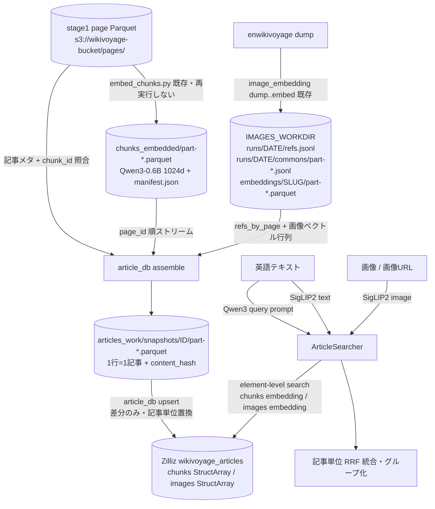
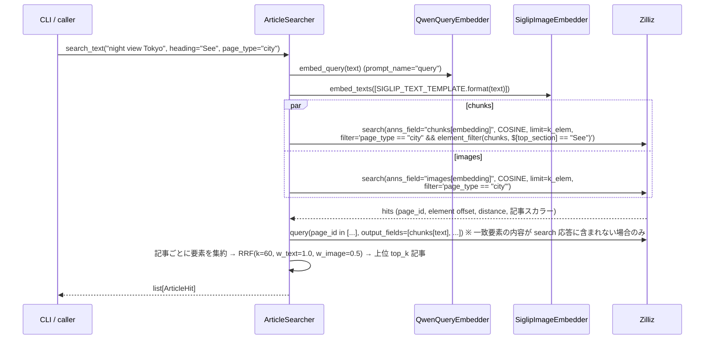
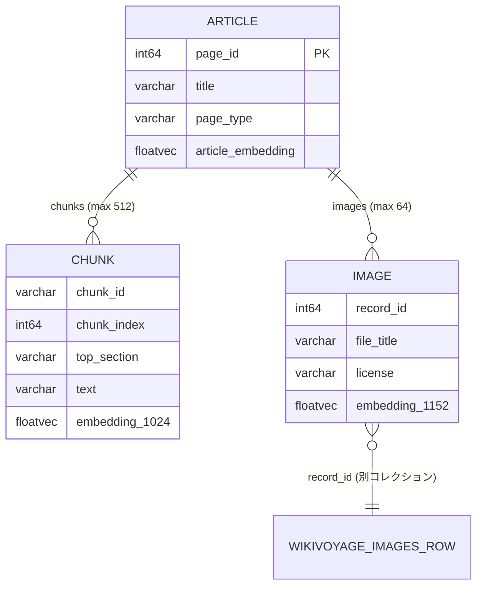

# Wikivoyage 記事 StructArray データベース（Qwen3 テキスト + SigLIP2 画像 → Zilliz `wikivoyage_articles`）— 設計書

- Status: Draft
- Date: 2026-11-14
- Source requirement: `design/specification2.md`・`design/specification3.md` — Wikivoyage ダンプから「1 記事 = 1 エンティティ、記事内チャンク = StructArray 要素」のテキスト＋画像データベースを Zilliz Cloud に構築する。テキストチャンクは `scripts/embed_chunks.py` と同じモデル（`Qwen/Qwen3-Embedding-0.6B`）で埋め込み、画像は SigLIP2 で埋め込む（specification3.md 5 行目のユーザー指定）。

---

## 1. 概要

既存リポジトリには、(a) `scripts/embed_chunks.py` が stage 1 のページ Parquet をセクション単位でチャンク化し Qwen3-Embedding-0.6B で埋め込んだ `chunks_embedded/part-*.parquet`（320,229 チャンク、M4 で約 2 日の計算結果）と、(b) `image_embedding/` パッケージが記事内画像を SigLIP2 で埋め込んだ中間成果物（`IMAGES_WORKDIR` の refs／Commons メタデータ／埋め込み Parquet）がある。本設計は **これらを再計算せずに page_id で結合**し、Zilliz Cloud の新コレクション `wikivoyage_articles` に「1 記事 = 1 エンティティ」として、テキストチャンクと画像をそれぞれ StructArray（Array of Structs）フィールドに格納する組み立て（assemble）・登録（upsert）・検索（search）の新パッケージ `article_db/` を追加する。これにより、記事単位の置換更新（古いチャンクが残らない）と、チャンク単位／画像単位の要素レベルベクトル検索・見出しフィルタを両立する。利用者はリポジトリ所有者（開発者）で、検索は当面 CLI／Python API として提供し、chatbot 統合は次フェーズとする。

## 2. スコープ

### In scope
- 既存成果物の読み込みと検証：`chunks_embedded/`（ローカルまたは `s3://wikivoyage-bucket/chunks_embedded/`）、stage 1 ページ Parquet（記事メタデータ）、`IMAGES_WORKDIR` の `refs.jsonl`・`commons/part-*.jsonl`・`embeddings/<model_slug>/part-*.parquet`
- page_id による結合、記事エンティティ（スカラー + `chunks` StructArray + `images` StructArray + 記事ベクトル）の組み立てとスナップショット Parquet 出力
- Zilliz コレクション `wikivoyage_articles` の作成・スキーマ互換性検証・バイト数上限付きバッチ登録・記事単位置換・失敗バッチ退避と `replay`・差分登録（content_hash）・消えた記事の prune
- 検索モジュールと CLI：英語テキスト → Qwen3（query プロンプト）→ `chunks[embedding]`、テキスト → SigLIP2 テキストエンコーダ → `images[embedding]`、画像 → SigLIP2 画像エンコーダ → `images[embedding]`、記事単位での統合（RRF）・グループ化、記事スカラー／見出し（element_filter）フィルタ
- 実装着手前の Zilliz StructArray 検証スパイク（§10 タスク 1）
- `status` サブコマンド、実行サマリ、テスト

### Out of scope
- テキストチャンクの再チャンク化・再埋め込み（`scripts/embed_chunks.py` の成果物をそのまま使う。設定変更時の再実行は既存スクリプトで行う）
- 画像パイプライン（dump〜embed）の変更・再実行。本設計は `image_embedding` の出力を読むだけ
- 既存コレクション `wikivoyage_pages`（BGE-M3、chatbot 用）・`wikivoyage_images` の変更・削除
- BGE-M3 スパースベクトルの格納（StructArray のサブフィールドはスパースベクトル非対応のため。キーワード検索が必要なら §12 参照）
- `chatbot/`（HF Spaces）への組み込み、Qwen2.5-VL 等による回答生成（specification2.md の「回答生成」はフェーズ 2）
- 日本語版 Wikivoyage（`wiki` フィールドと設定で拡張点のみ用意）
- EmbeddingList 検索（MAX_SIM 系）。1 サブフィールドに 1 インデックスしか張れないため、要素レベル検索（COSINE）を採用する（§5.4）
- 画像と特定チャンクの紐付け（画像がどのセクションにあるかの推定は FR-Could として任意実装）

## 3. 機能要件

| ID | 要件 | 優先度 |
|---|---|---|
| FR-01 | `chunks_embedded` の `manifest.json` を読み、`model == "Qwen/Qwen3-Embedding-0.6B"`・`max_chars`・`min_chars`・`page_types`・`skip_stub`・`chunks` を記録する。`model` が想定と異なれば終了コード 1 | Must |
| FR-02 | `chunks_embedded/part-*.parquet` を全件読み、全パート揃っていること（`ceil(chunks / rows_per_part)` 個、行数合計 = `manifest.chunks`）を検証する。欠損時は終了コード 5（`--allow-partial` で警告のみ） | Must |
| FR-03 | 各チャンクの `embedding` が長さ 1024・L2 ノルム 1±1e-3 であることを検証し、違反行は除外してサマリに計上する | Must |
| FR-04 | stage 1 ページ Parquet から `page_id, title, page_type, status, is_part_of, url, revision_id, timestamp, sections` を読み、記事スカラーを得る。チャンクの元になったページ集合と一致することを `embed_chunks.build_chunks` と同一規則で chunk_id を再導出して照合する（`--verify-chunks`、既定 on） | Must |
| FR-05 | `image_embedding` の `refs.jsonl`（指定 `--image-dump-date`）・Commons メタデータ（`status=ok`、last-wins）・埋め込み Parquet（`commons_sha1` 一致のもののみ）を `image_embedding` 既存関数で読み、`source_page_id` で記事にぶら下げる | Must |
| FR-06 | 1 記事 = 1 エンティティ。主キー = Wikivoyage `page_id`（INT64） | Must |
| FR-07 | `chunks` StructArray：要素 = 1 チャンク。`chunk_id`, `text`（= 埋め込み対象の `chunk_text` そのもの）, `heading`, `top_section`, `section_path`, `chunk_index`, `url`（アンカー付き）, `embedding`（1024） | Must |
| FR-08 | `images` StructArray：要素 = 記事内の 1 画像。`record_id`, `file_title`, `file_key`, `image_url`, `image_page_url`, `caption`, `license`, `license_url`, `artist`, `position`, `embedding`（1152） | Must |
| FR-09 | 記事ベクトル `article_embedding` = チャンク埋め込みの平均を L2 正規化したもの（1024、Qwen3 空間）を持つ | Should |
| FR-10 | チャンク数が `ARTICLES_MAX_CHUNKS`（既定 512）を超える記事は先頭から上限まで格納し、超過を `overflow.jsonl` とサマリに記録する。画像は `ARTICLES_MAX_IMAGES`（既定 64）で同様 | Must |
| FR-11 | 画像のない記事は `images = []` で登録する（スパイクで空配列が拒否された場合は §8 のフォールバック）。チャンク 0 件の記事は登録しない（`skipped_no_chunks`） | Must |
| FR-12 | サブフィールドに null を入れない（On-Demand クラスタでは要素レベル null 非対応）。欠損文字列は `""`、欠損整数は `-1` | Must |
| FR-13 | 組み立て結果を `snapshots/<snapshot_id>/part-*.parquet` に保存し、各記事に `content_hash`（ベクトル以外の全フィールド + 埋め込みモデル ID + 画像 `commons_sha1` 列の SHA-256）を付与する | Must |
| FR-14 | コレクションが無い場合のみ作成（スキーマ・インデックスは §6.3）。存在する場合はスキーマ互換性を検証し、不一致なら終了コード 3 | Must |
| FR-15 | 登録は記事単位の置換。スパイクで StructArray の upsert が使えれば `upsert`、使えなければ `delete(page_id in [...])` → `insert` | Must |
| FR-16 | バッチは件数（既定 50 記事）とシリアライズ後バイト数（既定 8 MB）の両方で区切る | Must |
| FR-17 | 登録済み `(page_id, content_hash)` を `state/done-*.jsonl` に記録し、再実行・次回スナップショットでは content_hash が変わった記事だけ送る | Must |
| FR-18 | 失敗バッチ（3 回再試行後）を `snapshots/<id>/upsert/failed/batch-*.parquet` に退避し、`replay` で再送できる | Must |
| FR-19 | `--prune` 指定時、失敗 0 件の場合のみ、スナップショットに存在しない page_id をコレクションから削除する | Should |
| FR-20 | 検索：テキストクエリで Qwen3（query プロンプト）→ `chunks[embedding]` の要素レベル検索、SigLIP2 テキスト → `images[embedding]` の要素レベル検索を行い、記事単位に RRF で統合して返す | Must |
| FR-21 | 検索：画像（ファイル／URL）クエリで SigLIP2 画像エンコーダ → `images[embedding]` 検索 | Must |
| FR-22 | 検索結果は記事ごとにグループ化し、記事あたり最大 `--per-article`（既定 3）チャンク・3 画像を、`title`, `url`, `page_type`, `is_part_of`, 一致要素（offset, text/heading/url または image_url/caption/license/artist）, スコアとともに返す | Must |
| FR-23 | フィルタ：記事スカラー（`page_type`, `is_part_of`, `title`, `status`）と、チャンク見出し（`--heading Sleep` → `element_filter(chunks, $[top_section] == "Sleep")`） | Must |
| FR-24 | `status` サブコマンドで、入力件数、スナップショット件数、登録済み・未登録・失敗件数、コレクション行数を表示する | Should |
| FR-25 | `--dry-run` で組み立て・検証のみ行い Zilliz に書かない | Should |
| FR-26 | 画像のセクション推定：ページ wikitext 内で `file_title` の名前が最初に出現する位置の見出しを `images[section_path]` に入れる（推定不可は `""`） | Could |
| FR-27 | 検索モード `--mode text|image|both`（既定 both）でテキスト・画像どちらかだけを検索できる | Should |

### 主要ユースケースフロー

**UC-1 初回構築（正常系）**
1. 前提：`scripts/embed_chunks.py` 完了（`chunks_embedded/` 65 パート）、`python -m image_embedding all --dump-date 20261101` の `embed` まで完了。
2. `python -m article_db assemble --image-dump-date 20261101` → 入力検証 → `articles_work/snapshots/<snapshot_id>/part-*.parquet`、`summary/assemble-<run_id>.json`。
3. `python -m article_db upsert` → コレクション作成（初回）→ 記事単位で登録 → `state/done-*.jsonl`。
4. `python -m article_db search --text "night view in Tokyo" --heading See`。

**UC-2 中断からの再開**：`upsert` を同じ引数で再実行すると、`state/done-*` の `(page_id, content_hash)` と一致する記事は送らない。delete→insert 方式で delete 後に落ちた記事は done に無いので再送される（冪等）。

**UC-3 次のダンプ／再埋め込み後の差分更新**：stage 1 → `embed_chunks.py`（新 workdir）→ 画像パイプラインを再実行後、`assemble` で新スナップショットを作成し `upsert --prune`。content_hash が同じ記事は送らず、変わった記事は置換、消えた記事は削除。

**UC-4 画像だけ更新**：画像パイプラインのみ新しいダンプ日付で再実行 → `assemble --image-dump-date <新>` → `upsert`。画像要素が変わった記事だけ置換される。

**エラー系**
- E-1 `chunks_embedded` のパート欠損・manifest 不一致 → 終了コード 5（FR-01, FR-02）。
- E-2 `--verify-chunks` で chunk_id 集合がページ Parquet と不一致（ページ Parquet が別スナップショット）→ 終了コード 5、差分件数と例を表示（FR-04）。
- E-3 画像埋め込みの `model_info.json` の dim が 1152 以外 → 終了コード 3（スキーマ不一致扱い）。
- E-4 Zilliz 認証情報なし → 終了コード 1。スキーマ不一致 → 終了コード 3（データには書かない）。
- E-5 バッチ失敗（3 回再試行後）→ 退避して続行、最後に終了コード 4。`replay` で再送（FR-18）。
- E-6 サイズ超過（単一記事が `ARTICLES_MAX_BATCH_BYTES` を超える）→ その記事を単独バッチで送信し、それでも失敗なら退避（§8）。

## 4. 非機能要件

| 項目 | 要件・値 |
|---|---|
| データ規模（実測・見積り） | 現行 `chunks_embedded`：320,229 チャンク／25,281 記事（ページ Parquet 25,306 行）。記事あたりチャンク数 中央値 10・平均 12.7・p99 64・最大 206。`chunk_text` 最大 2,721 B（p99 2,032 B）。画像は記事あたり最大 50（`IMAGES_MAX_PER_PAGE`）、総数 20〜35 万（画像設計書の見積り） |
| エンティティサイズ | チャンク 1 要素 ≈ 4,096 B（ベクトル）+ 約 2.3 KB（テキスト・メタ）≈ 6.5 KB。画像 1 要素 ≈ 4,608 B + 約 2 KB ≈ 6.6 KB。平均記事 ≈ 12.7×6.5 + 10×6.6 ≈ 150 KB、最大記事 ≈ 206×6.5 + 50×6.6 ≈ 1.7 MB |
| コレクション総量 | ベクトル：チャンク 1.31 GB + 画像 ~1.4 GB + 記事 0.1 GB ≈ 2.8 GB。テキスト等 ~0.9 GB。合計 ~3.7 GB（Zilliz プラン容量の確認が必要。§12） |
| メモリ（assemble） | ピーク 4 GB 未満。チャンク Parquet は page_id 順（`embed_chunks.read_pages` が page_id でソート）なのでストリーミングで記事ごとに区切る。画像ベクトルはユニーク画像ぶん（~25 万 × 4.6 KB ≈ 1.2 GB）を `file_key → 行番号` 辞書付きの float32 numpy 行列に保持する |
| 処理時間 | assemble：入力読み込みが支配的で S3 から ~3 GB 取得込み 30 分以内（ローカル M4）。upsert：~3.7 GB を 8 MB バッチ（~460 リクエスト）で 1 時間以内を目標 |
| 検索レイテンシ | テキスト＋画像の両検索（2 回の search + 埋め込み 2 回）で p95 < 1.5 s（CPU/mps、モデル常駐時）。モデル初回ロードは除く |
| 冪等性 | 主キー = page_id。記事単位の置換と `(page_id, content_hash)` の done 記録で、何度実行しても 1 記事 1 エンティティ |
| 再開性 | done は 50 記事（1 バッチ）ごとにパート確定。クラッシュ時の再送は最大 1 バッチ |
| セキュリティ | `ZILLIZ_URI`/`ZILLIZ_TOKEN`/AWS 認証は環境変数（既存の `load_dotenv(<repo root>/.env)` 方式）。画像 URL 検索は `image_embedding.search.load_image_from_url` を再利用（http/https のみ、20 MB 上限） |
| 可観測性 | logger 名 `wikivoyage.articles.<stage>`、既存ログ形式。`articles_work/summary/<stage>-<run_id>.json` に入力件数・登録件数・スキップ理由別件数・overflow 件数・所要時間・モデル情報 |
| 再現性 | 各エンティティに `text_model`, `image_model`, `image_model_revision`, `chunk_manifest_sha`, `image_dump_date`, `snapshot_id` を保持 |
| コスト | 埋め込み計算ゼロ（既存成果物の再利用）。検索時のみ Qwen3-0.6B（~1.2 GB）と SigLIP2 so400m（~4.5 GB）を常駐 |

## 5. アーキテクチャ

### 5.1 コンポーネント

新規パッケージ `article_db/` を追加する。既存の `image_embedding/` からは読み取り用の関数を import して再利用し、`scripts/embed_chunks.py` のチャンク規則は複製せず照合用に import 相当の同一実装を持つ（§5.5）。

| モジュール | 責務 | 再利用する既存部品 |
|---|---|---|
| `article_db/__main__.py` | argparse サブコマンド `assemble` `upsert` `replay` `search` `status` `spike`。`.env` 読み込み、ロギング | `image_embedding/__main__.py` の `.env` 読み込み・ロギング初期化と同じ方式 |
| `article_db/config.py` | 環境変数・CLI を `ArticlesConfig` dataclass に集約 | `image_embedding.config` の `_env`/`_env_int` パターン、`StageError(code)` |
| `article_db/sources/chunks.py` | `chunks_embedded` の manifest 検証、パート列挙（S3 はローカルキャッシュ）、page_id 順ストリーム（`iter_pages_chunks() -> Iterator[(page_id, list[ChunkRow])]`） | `scripts/embed_chunks.py` の `_split_s3`/S3 キャッシュ方式 |
| `article_db/sources/pages.py` | ページ Parquet から記事スカラーを `dict[page_id, PageMeta]` で読む（`wikitext` は FR-26 有効時のみ）。`verify_chunk_ids()` | `embed_chunks.split_lines`/`build_chunks` と同一規則（§5.5） |
| `article_db/sources/images.py` | `image_embedding.storage.Store` で `IMAGES_WORKDIR` を開き、refs（page_id 別）・Commons（`commons.load_done`）・埋め込み（`embed.resolve_slug`/`iter_parquet_parts`）を読み、`ImageVectors`（numpy 行列 + `(file_key, commons_sha1) → idx`）と `refs_by_page` を作る | `image_embedding.commons.load_done`, `image_embedding.embed.resolve_slug`, `iter_parquet_parts`, `image_embedding.upsert.build_record` の URL・license 既定値規則 |
| `article_db/assemble.py` | 記事エンティティの組み立て・検証・overflow 処理・`content_hash`・スナップショット Parquet 出力 | `image_embedding.storage.PartWriter`（JSONL 系の記録） |
| `article_db/schema.py` | `wikivoyage_articles` のフィールド定義（`FieldSpec`/`StructSpec`）、`create_struct_field_schema` を使ったスキーマ生成、インデックス定義、`verify_schema`、行の検証（VARCHAR バイト切り詰め・dim・null 排除） | `image_embedding.zilliz.truncate_utf8`, `escape_filter_value`, `SchemaMismatch`, `make_client` |
| `article_db/collection.py` | `ArticleCollection`：`ensure`、`replace(rows)`（upsert または delete+insert、スパイク結果で `ARTICLES_WRITE_MODE` 切替）、`prune`、`count` | `image_embedding.zilliz.RETRY_DELAYS` |
| `article_db/upsert.py` | スナップショット読込 → done 照合 → バイト数制限付きバッチ → 送信・退避・done 記録、`replay` | `image_embedding.upsert._BatchSender` の構造 |
| `article_db/text_embedder.py` | `QwenQueryEmbedder`：`sentence-transformers` で `Qwen/Qwen3-Embedding-0.6B` を読み、クエリを `prompt_name="query"` で埋め込み（L2 正規化） | `embed_chunks.load_model`/`embed` と同じ引数（fp16 on mps/cuda、`max_seq_length=1024`） |
| `article_db/search.py` | `ArticleSearcher`：テキスト／画像検索、フィルタ組み立て、RRF 統合、記事グループ化 | `image_embedding.embedder.SiglipImageEmbedder`, `image_embedding.search.load_image_from_url`, `image_embedding.preprocess.to_rgb` |
| `article_db/status.py` | 集計表示 | — |
| `scripts/spike_structarray.py` | §10 タスク 1 の検証スクリプト（テストコレクション `wikivoyage_articles_spike` を作成・検証・削除） | — |

**使わないもの**：`embedding/`（BGE-M3、`wikivoyage_pages` 用）、`wikivoyage_pipeline/`・`pipeline.py`（デッドコード）。

### 5.2 メインフロー



### 5.3 検索シーケンス（テキストクエリ、mode=both）



### 5.4 主要な設計判断

1. **テキストと画像を別の StructArray に分ける（specification3 の `chunks.image_embedding` からの変更）**。specification3 は `chunks` 要素に `embedding` と `image_embedding` を同居させるが、画像はチャンクと 1:1 に対応しない（画像はセクション外の pagebanner・listing・gallery にもあり、記事あたり最大 50 枚、チャンクは最大 206）。同居させると (a) 画像の無いチャンクに埋めるベクトルが必要になり（サブフィールドの null は On-Demand 非対応、ゼロベクトルは COSINE で未定義）、(b) 1 画像を複数チャンクに複製するか恣意的に 1 チャンクへ割り当てる必要があり、検索結果が歪む。`images` を独立した StructArray にすれば、要素 = 実在の 1 画像となり、ライセンス情報も画像要素に自然に置ける。ベクトルフィールド数は 3（`article_embedding`, `chunks[embedding]`, `images[embedding]`）で上限 10 内。
2. **テキストは specification2 の推奨どおり専用モデル、ただしモデルは Qwen3-Embedding-0.6B に固定**（ユーザー指定）。specification2 の候補（jina-v3／bge-m3／nomic）ではなく、既存 `chunks_embedded` と同じモデルを使うことで約 2 日の再計算を避ける。クエリは必ず `prompt_name="query"`、文書はプロンプトなし（`embed_chunks.embed` と同じ非対称性）。
3. **要素レベル検索（COSINE）を採用し、EmbeddingList（MAX_SIM）は採用しない**。1 サブフィールドに張れるインデックスは 1 つで、本用途の主目的は「一致したチャンク・画像そのもの」を返すこと（RAG の文脈・画像表示）であるため、一致要素の offset が得られる要素レベル検索が適する。記事単位の集約はクライアント側で行う。
4. **テキスト × 画像の統合はクライアント側 RRF**。2 つのモデルのスコアは尺度が異なり（Qwen3 COSINE と SigLIP2 COSINE は分布が違う）、StructArray サブフィールドでの `hybrid_search` 対応は未確認のため、2 回の `search` を並列に呼び、記事ごとに要素の最良順位で RRF する。
5. **記事ベクトル `article_embedding` をトップレベルに持つ**。チャンク埋め込み平均の正規化で計算コストはゼロ。コレクションにトップレベルのベクトルフィールドが必須かどうかが未確認であることへの保険を兼ね、「この記事に似た記事」検索にも使える。
6. **assemble と upsert を分けスナップショットを残す**。結合結果を Parquet に固定することで、upsert の再開・`replay`・差分（content_hash）・`--dry-run` 検証が Zilliz 側の状態に依存しない。`image_embedding` と同じ「不変パートファイル + last-wins」方式。
7. **主キーは page_id**。1 記事 1 エンティティなので stage 2 の `page_id*1000+chunk` 問題は起きない。chunk_id は `embed_chunks` の `{page_id}-{sec_idx}-{part}` をそのまま保持する。

### 5.5 既存コードへの変更

| ファイル | 変更 |
|---|---|
| `article_db/`（新設） | §5.1 のモジュール群、`requirements.txt`（`pyarrow>=14`, `boto3>=1.28`, `numpy`, `pymilvus>=2.6`（StructArray API `create_struct_field_schema`。開発 venv は 3.0.0。最小版はスパイクで確定）, `python-dotenv>=1.0`）、`requirements-search.txt`（`-r requirements.txt` + `sentence-transformers>=3`, `torch>=2.3` + `-r ../image_embedding/requirements-embed.txt`） |
| `scripts/embed_chunks.py` | **変更しない**（実行中・実行済み成果物との一致を保つため）。`article_db/sources/pages.py` に `split_lines`/`build_chunks` の同一実装を置き、`tests/article_db/test_chunk_rules.py` で両者が同じ chunk_id・chunk_text を返すことを固定する（`scripts/` はパッケージではなく import できないため） |
| `scripts/spike_structarray.py`（新設） | スパイク用 |
| `image_embedding/` | 変更しない（`commons.load_done`, `embed.resolve_slug`, `embed.iter_parquet_parts`, `storage.make_store` 相当、`zilliz.truncate_utf8`/`escape_filter_value`、`embedder.SiglipImageEmbedder`、`search.load_image_from_url` を import のみ）。torch を import するのは `embedder.py` だけという規約を `article_db` でも守る（`text_embedder.py` と `search.py` 内で遅延 import） |
| `.env.example` | §7.4 の変数を追記 |
| `.gitignore` | `articles_work/` を追加 |
| `requirements_all.txt` | `-r article_db/requirements-search.txt` を追記 |
| `pytest.ini` | マーカー `milvus`（StructArray 対応 Milvus への結合テスト）を追加 |
| `CLAUDE.md` / `README.md` | 「Article DB（StructArray）」節：コマンド、入力の前提、環境変数 |

**実行場所**：`assemble`/`upsert`/`replay`/`status` はローカル（CPU のみ、メモリ 4 GB）。Docker・AWS Batch は用意しない（入力が既に S3 にあり、処理が 1 時間程度のため）。`search` はモデル 2 つを読むため mps/cuda 推奨。

## 6. データモデル

### 6.1 入力と結合キー

| 入力 | 場所（既定） | 使う列 | キー |
|---|---|---|---|
| チャンク | `ARTICLES_CHUNKS_SOURCE`=`s3://wikivoyage-bucket/chunks_embedded/`（ローカル `chunks_embedded/` も可） | `chunk_id, page_id, section, url, chunk_text, embedding` | `page_id` |
| チャンク manifest | 同上 `manifest.json` | 全キー | — |
| ページ | `ARTICLES_PAGES_SOURCE`=`s3://wikivoyage-bucket/pages/`（`embed_chunks --source` と同一であること） | `page_id, title, page_type, status, is_part_of, url, revision_id, timestamp, sections`（FR-26 時のみ `wikitext`） | `page_id` |
| 画像参照 | `IMAGES_WORKDIR/runs/<image_dump_date>/refs.jsonl` | `source_page_id, revision_id, file_title, file_key, record_id, position, caption` | `source_page_id` |
| Commons | `IMAGES_WORKDIR/runs/<date>/commons/part-*.jsonl`（last-wins、`status=ok`） | `file_key, thumb_url, description_url, license_short_name, license_url, artist, commons_sha1` | `file_key` |
| 画像埋め込み | `IMAGES_WORKDIR/embeddings/<model_slug>/part-*.parquet` + `model_info.json` | `file_key, commons_sha1, vector, model_id, model_revision` | `(file_key, commons_sha1)` |

画像要素の採用条件は `image_embedding.upsert.run` と同一：Commons `status=ok` かつ埋め込みの `commons_sha1` が Commons の最新値と一致。満たさない参照は `images_pending` として計上し要素にしない。

チャンクから導出する値：
- `section_path` = `section`（`embed_chunks` の `s["path"] or "Overview"`、例 `Sleep > Budget`）
- `heading` = `section_path.split(" > ")[-1]`、`top_section` = `section_path.split(" > ")[0]`（「Sleep」で絞ると `Sleep > Budget` も含む）
- `chunk_index` = 記事内で `(sec_idx, part)`（chunk_id を数値分解）昇順に並べた 0 始まりの連番

### 6.2 作業領域（`ARTICLES_WORKDIR`、既定 `articles_work/`、ローカルまたは `s3://…`、`image_embedding.storage.Store` を流用）

```
articles_work/
  cache/chunks/part-*.parquet            # S3 入力のローカルキャッシュ（サイズ一致なら再取得しない）
  cache/pages/part-*.parquet
  snapshots/<snapshot_id>/               # snapshot_id = run_id（UTC タイムスタンプ先頭）
    snapshot.json                        # 入力の要約：chunk manifest + その SHA-256、pages source、image_dump_date、image model_slug、件数
    part-<seq>.parquet                   # 1 行 = 1 記事エンティティ（§6.4 と同じ列 + content_hash）
    overflow.jsonl                       # 上限超過で切り捨てた記事と件数
    skipped.jsonl                        # skipped_no_chunks など
    upsert/failed/batch-<run_id>-<seq>.parquet
    upsert/replayed/…
  state/done-<run_id>-<seq>.jsonl        # {"page_id", "content_hash", "snapshot_id", "at"}、last-wins
  state/deleted-<run_id>-<seq>.jsonl     # prune で消した page_id
  summary/<stage>-<run_id>.json
```

`upsert` は既定で最新の `snapshots/*`（名前順最後）を使い、`--snapshot <id>` で指定できる。

### 6.3 Zilliz コレクション `wikivoyage_articles`

`enable_dynamic_field=False`、`auto_id=False`。VARCHAR の `max_length` は UTF-8 バイト数で、超過は文字境界で切り詰めて警告（`truncate_utf8`）。

**記事レベル（トップレベル）フィールド**

| フィールド | 型 | 制約 | 内容 |
|---|---|---|---|
| `page_id` | INT64 | PK | Wikivoyage page id |
| `wiki` | VARCHAR(32) | | `enwikivoyage` |
| `title` | VARCHAR(512) | | |
| `url` | VARCHAR(2048) | | 記事 URL（アンカーなし） |
| `page_type` | VARCHAR(32) | | `city` / `region` / … |
| `status` | VARCHAR(32) | | `stub` / `usable` / … （不明は `""`） |
| `is_part_of` | VARCHAR(512) | nullable | 親地域 |
| `revision_id` | INT64 | nullable | ページ Parquet の値 |
| `last_updated` | INT64 | nullable | `timestamp` の Unix 秒 |
| `chunk_count` | INT64 | | 格納したチャンク数 |
| `image_count` | INT64 | | 格納した画像数 |
| `chunks_truncated` | BOOL | | FR-10 で切り捨てたか |
| `article_embedding` | FLOAT_VECTOR(1024) | | チャンク埋め込み平均の L2 正規化（Qwen3 空間） |
| `text_model` | VARCHAR(128) | | `Qwen/Qwen3-Embedding-0.6B` |
| `image_model` | VARCHAR(128) | | `google/siglip2-so400m-patch16-384`（画像 0 件でも記録） |
| `image_model_revision` | VARCHAR(64) | | `model_info.json` の commit hash |
| `chunk_manifest_sha` | VARCHAR(64) | | `manifest.json` の SHA-256（チャンク設定の識別） |
| `image_dump_date` | VARCHAR(16) | | 画像パイプラインのダンプ日付 |
| `snapshot_id` | VARCHAR(64) | | |
| `content_hash` | VARCHAR(64) | | FR-13 |
| `created_at` | INT64 | | 登録時エポックミリ秒 |

**`chunks`：ARRAY<STRUCT>、`max_capacity` = `ARTICLES_MAX_CHUNKS`（既定 512。現データ最大 206 の約 2.5 倍）**

| サブフィールド | 型 | 内容 |
|---|---|---|
| `chunk_id` | VARCHAR(64) | `{page_id}-{sec_idx}-{part}` |
| `chunk_index` | INT64 | 0 始まり連番（§6.1） |
| `heading` | VARCHAR(256) | 直近見出し（`Budget`） |
| `top_section` | VARCHAR(256) | 最上位見出し（`Sleep`） |
| `section_path` | VARCHAR(1024) | `Sleep > Budget` |
| `url` | VARCHAR(2048) | `<記事URL>#<anchor>` |
| `text` | VARCHAR(8192) | 埋め込み対象の `chunk_text`（先頭行 `"{title} ({page_type}, {is_part_of}) — {section}"` を含む） |
| `embedding` | FLOAT_VECTOR(1024) | Qwen3、L2 正規化済み |

**`images`：ARRAY<STRUCT>、`max_capacity` = `ARTICLES_MAX_IMAGES`（既定 64。画像パイプラインの上限 50 より大）**

| サブフィールド | 型 | 内容（欠損時） |
|---|---|---|
| `record_id` | INT64 | `wikivoyage_images` の主キーと同じ値（両コレクションの対応付け用） |
| `position` | INT64 | 記事内出現順（1 始まり） |
| `file_title` | VARCHAR(1024) | `File:…` |
| `file_key` | VARCHAR(40) | |
| `image_url` | VARCHAR(2048) | Commons サムネイル URL（768px） |
| `image_page_url` | VARCHAR(2048) | Commons ファイルページ |
| `caption` | VARCHAR(2048) | （`""`） |
| `section_path` | VARCHAR(1024) | FR-26（`""`） |
| `license` | VARCHAR(256) | （`"unknown"`） |
| `license_url` | VARCHAR(1024) | （`""`） |
| `artist` | VARCHAR(1024) | （`""`） |
| `embedding` | FLOAT_VECTOR(1152) | SigLIP2 画像埋め込み、L2 正規化済み |

**インデックス**

| 対象 | インデックス | メトリック | 用途 |
|---|---|---|---|
| `chunks[embedding]` | HNSW（M=16, efConstruction=200。スパイクで AUTOINDEX が可なら AUTOINDEX） | COSINE（要素レベル） | テキスト検索 |
| `images[embedding]` | 同上 | COSINE（要素レベル） | 画像検索 |
| `article_embedding` | AUTOINDEX | COSINE | 類似記事 |
| `chunks[top_section]`, `chunks[heading]` | INVERTED | — | element_filter |
| `page_type`, `title`, `is_part_of`, `snapshot_id` | INVERTED | — | 記事フィルタ・prune 補助 |



**スナップショット Parquet の型**：トップレベルは対応する Arrow 型、`chunks` は `list<struct<chunk_id: string, chunk_index: int64, …, embedding: list<float32>>>`、`images` も同様。Zilliz 送信時は行 dict（`{"chunks": [{"chunk_id": …, "embedding": [...]}, …]}`）に変換する（pymilvus の StructArray 挿入形式）。

**ストレージ選択の理由**：Zilliz は既存と同じクラスタ・認証を使い、新コレクションのみ追加（既存 2 コレクションに影響しない）。中間はベクトルを含むため Parquet（JSON だと約 3 倍）。進捗記録は JSONL パート（`image_embedding` と同方式）。

## 7. インターフェース

### 7.1 CLI（`python -m article_db <subcommand>`、リポジトリルートで実行）

共通：`--workdir`（`ARTICLES_WORKDIR`）、`--collection`（`ZILLIZ_ARTICLE_COLLECTION`）、`--log-level`。

| サブコマンド | 主なオプション | 入力 → 出力 | 終了コード |
|---|---|---|---|
| `assemble` | `--chunks-source`, `--pages-source`, `--images-workdir`（`IMAGES_WORKDIR`）, `--image-dump-date`（`IMAGES_DUMP_DATE`、必須）, `--image-model-slug`（省略時 `resolve_slug`）, `--no-images`（テキストのみで構築）, `--verify-chunks/--no-verify-chunks`, `--allow-partial`, `--limit N`（記事数、デバッグ用）, `--page-types` | 既存成果物 → `snapshots/<id>/` | 0 / 1 / 3（画像 dim 不一致）/ 5（入力不整合） |
| `upsert` | `--snapshot`, `--batch-size`（50）, `--max-batch-bytes`（8 MB）, `--write-mode {auto,upsert,replace}`, `--prune`, `--dry-run`, `--force`（content_hash を無視して全送信） | スナップショット → Zilliz | 0 / 1 / 3 / 4 |
| `replay` | `--snapshot`, `--file` | 退避バッチ → Zilliz | 0 / 3 / 4 |
| `search` | `--text "…"` \| `--image PATH` \| `--image-url URL`、`--mode {both,text,image}`、`--top-k`（10 記事）、`--per-article`（3）、`--page-type`、`--is-part-of`、`--title`、`--heading`（top_section）、`--json` | Zilliz → 標準出力 | 0 / 1 |
| `status` | `--snapshot` | 集計表示 | 0 |
| `spike` | `--keep`（検証用コレクションを残す） | `scripts/spike_structarray.py` を呼ぶ | 0 / 1 |

### 7.2 Python API

```python
# article_db/assemble.py
@dataclass
class AssembleStats:
    pages: int; articles: int; chunks: int; images: int
    skipped_no_chunks: int; chunks_truncated: int; images_truncated: int
    images_pending: int; invalid_chunks: int; revision_mismatch: int
def run(cfg: ArticlesConfig, store: Store, *, run_id: str, limit: int = 0) -> AssembleStats

def build_article(page: PageMeta, chunks: list[ChunkRow], images: list[ImageElem], *,
                  ctx: SnapshotContext) -> dict          # §6.3 の行 + content_hash
def content_hash(row: dict) -> str

# article_db/collection.py
class ArticleCollection:
    def __init__(self, client, name: str, *, text_dim=1024, image_dim=1152,
                 max_chunks=512, max_images=64, write_mode: str = "auto")
    def ensure(self, *, create: bool = True) -> bool     # SchemaMismatch を送出
    def replace(self, rows: list[dict]) -> None          # upsert か delete+insert
    def prune(self, keep_page_ids: set[int]) -> int
    def count(self) -> int | None

# article_db/text_embedder.py
class QwenQueryEmbedder:
    def __init__(self, model_id="Qwen/Qwen3-Embedding-0.6B", device="auto", max_seq_length=1024)
    def embed_queries(self, texts: list[str]) -> np.ndarray   # (n, 1024) float32, prompt_name="query", L2
    def embed_documents(self, texts: list[str]) -> np.ndarray # prompt="" （テスト・類似記事用）

# article_db/search.py
@dataclass
class ChunkMatch:  score: float; rank: int; chunk_id: str; heading: str; section_path: str; url: str; text: str
@dataclass
class ImageMatch:  score: float; rank: int; file_title: str; image_url: str; image_page_url: str
                   caption: str; license: str; license_url: str; artist: str
@dataclass
class ArticleHit:  page_id: int; title: str; url: str; page_type: str; is_part_of: str | None
                   score: float; chunks: list[ChunkMatch]; images: list[ImageMatch]
class ArticleSearcher:
    def __init__(self, client, *, text_embedder: QwenQueryEmbedder | None,
                 image_embedder: SiglipImageEmbedder | None, collection="wikivoyage_articles",
                 rrf_k=60, w_text=1.0, w_image=0.5, element_limit=100)
    def search_text(self, text: str, *, mode="both", top_k=10, per_article=3, filters: SearchFilters | None = None) -> list[ArticleHit]
    def search_image(self, image, *, top_k=10, per_article=3, filters=None) -> list[ArticleHit]
    def search_image_url(self, url: str, **kw) -> list[ArticleHit]
```

### 7.3 Zilliz 呼び出し仕様

- **スキーマ作成**：`schema.add_field("chunks", DataType.ARRAY, element_type=DataType.STRUCT, struct_schema=client.create_struct_field_schema(...), max_capacity=512)`。サブフィールドに `nullable`・`enable_match`・`analyzer`・Function は付けない。
- **要素レベル検索（テキスト）**：`client.search(collection_name, data=[qvec], anns_field="chunks[embedding]", limit=element_limit, filter=<記事フィルタ> [&& element_filter(chunks, …)], search_params={"metric_type": "COSINE", "params": {"ef": 128}}, output_fields=["page_id","title","url","page_type","is_part_of"])`。応答の一致要素 offset から `chunks[offset]` を特定する。`output_fields` に `chunks[text]` 等を指定して一致要素のみ返るか、配列全体が返るかはスパイクで確認し、後者または非対応なら上位記事に対し `client.query(filter="page_id in [...]", output_fields=["page_id","chunks[chunk_id]","chunks[text]",…])` を 1 回発行して offset で引く。
- **フィルタ組み立て**：記事条件を `&&` で連結し、`element_filter` は式の末尾に 1 回だけ置く（`element_filter(chunks, $[top_section] == "Sleep")`）。文字列は `escape_filter_value` でエスケープ。`images` 側には見出しフィルタを適用しない（FR-26 実装後は `images` の `section_path` で可）。
- **記事単位の置換**：`write_mode=upsert` → `client.upsert(rows)`。`replace` → `client.delete(filter=f"page_id in {ids}")` → `client.insert(rows)`。`auto` はスパイク結果を `articles_work/spike.json` から読み、無ければ `replace`。
- **prune**：`client.query(filter="page_id >= 0", output_fields=["page_id"])` をイテレータ（`query_iterator`）で全取得し、スナップショットに無い ID を 500 件ずつ `delete`。

### 7.4 環境変数

| 変数 | 既定 | 用途 |
|---|---|---|
| `ZILLIZ_URI`, `ZILLIZ_TOKEN` | — | 既存と共有（upsert/replay/search で必須） |
| `ZILLIZ_ARTICLE_COLLECTION` | `wikivoyage_articles` | 既存 `ZILLIZ_COLLECTION`・`ZILLIZ_IMAGE_COLLECTION` とは別 |
| `ARTICLES_WORKDIR` | `articles_work` | ローカルまたは `s3://…` |
| `ARTICLES_CHUNKS_SOURCE` | `s3://wikivoyage-bucket/chunks_embedded/` | `embed_chunks --dest` と同じ |
| `ARTICLES_PAGES_SOURCE` | `s3://wikivoyage-bucket/pages/` | `embed_chunks --source` と同じ |
| `ARTICLES_TEXT_MODEL` | `Qwen/Qwen3-Embedding-0.6B` | manifest と一致検証 |
| `ARTICLES_MAX_CHUNKS` / `ARTICLES_MAX_IMAGES` | 512 / 64 | `max_capacity` |
| `ARTICLES_BATCH_SIZE` / `ARTICLES_MAX_BATCH_BYTES` | 50 / 8388608 | |
| `ARTICLES_WRITE_MODE` | `auto` | `upsert` / `replace` / `auto` |
| `ARTICLES_RRF_K`, `ARTICLES_W_TEXT`, `ARTICLES_W_IMAGE` | 60 / 1.0 / 0.5 | 検索統合 |
| `QWEN_DEVICE` | `auto` | mps → cuda → cpu |
| `IMAGES_WORKDIR`, `IMAGES_DUMP_DATE`, `SIGLIP_*` | 画像パイプラインの既定 | 入力の場所と検索時の SigLIP2 設定を共有 |

### 7.5 UI

N/A — CLI と Python API のみ。chatbot への組み込みはフェーズ 2（§12）。

## 8. エラー処理とエッジケース

| ケース | 挙動 |
|---|---|
| `chunks_embedded` が embed 途中（パート不足） | 終了コード 5。`--allow-partial` なら存在するチャンクだけで記事を作り、`snapshot.json` に `partial: true`。partial スナップショットでは `--prune` を拒否 |
| チャンク Parquet が page_id 順でない（将来の変更） | ストリーム中に page_id の逆行を検出したら、全チャンクを page_id で外部ソート（パートごとに読み page_id→(part,row) 索引を作り、記事単位に読む）するモードに切り替えて警告 |
| 同一 page_id の記事が複数パートにまたがる | ストリームの「page_id が変わるまで蓄積」で自然に結合 |
| `--verify-chunks` 不一致（ページ Parquet が埋め込み時と別） | 終了コード 5。差分（欠落・余剰 chunk_id 数、例 10 件）を表示 |
| 同じ chunk_id が重複 | 先勝ちで 1 つに、警告（`embed_chunks.read_pages` は page_id 重複を先勝ちで除去済み） |
| 埋め込み長 ≠ 1024 またはノルム異常 | そのチャンクを除外し `invalid_chunks` 計上 |
| 記事の全チャンクが除外／0 件 | 記事を登録しない（`skipped.jsonl`、`skipped_no_chunks`） |
| チャンク数 > 512 | `chunk_index` 昇順で先頭 512 件、`chunks_truncated=true`、`overflow.jsonl` |
| 画像数 > 64 | `position` 昇順で先頭 64 件 |
| 画像なし記事 | `images=[]`。スパイクで空配列が拒否された場合：`images` に `file_key=""`, `position=-1`, `embedding`= 固定の単位ベクトル e₀ のプレースホルダ 1 要素を入れ、画像検索は常に `element_filter(images, $[position] >= 0)` を付ける（`image_count=0` は正しく保持） |
| 画像 refs の `revision_id` ≠ ページ Parquet の `revision_id` | 画像はそのまま採用し `revision_mismatch` 計上（`--strict-revision` で当該記事の画像を除外） |
| 画像は refs にあるが Commons 未取得／埋め込み未計算／`commons_sha1` 不一致 | 要素にしない（`images_pending`）。content_hash が変わるので次回 assemble で揃えば自動で置換される |
| 画像 `model_info.json` の dim ≠ 1152 | 終了コード 3 |
| VARCHAR 超過（例 caption > 2048 B、text > 8192 B） | 文字境界で切り詰め、警告件数を計上。`text` は現データ最大 2,721 B なので通常発生しない |
| サブフィールドに None | 検証で `""`/`-1`/`"unknown"` に置換（FR-12）。トップレベルの nullable フィールドのみ None 可 |
| 1 記事でバッチ上限超過 | その記事単独で送信。失敗したら退避（サイズ上限はスパイクで確認） |
| delete 成功・insert 失敗（replace モード） | その記事はコレクションから一時的に欠落。done に記録しないので再実行／`replay` で復旧。終了コード 4 で通知 |
| upsert／replay の一時エラー | 1, 2, 4 s で 3 回再試行後に退避 |
| `--prune` 時に失敗バッチ・partial | prune しない（誤削除防止） |
| 検索：`element_limit` 件の要素が少数の記事に集中 | `element_limit` を `top_k × per_article × 3`（下限 50、上限 1000）にし、記事数が `top_k` に満たなければ `element_limit` を 2 倍にして 1 回だけ再検索 |
| 検索：モデル未導入 | `--mode text` 時は SigLIP2 を読まない／`--mode image` 時は Qwen3 を読まない。必要なモデルの import 失敗は終了コード 1 と導入コマンドを表示 |
| 検索：見出し指定と画像検索 | 画像側には見出しフィルタを掛けない旨をヘルプに明記 |
| `torch` と Milvus Lite／faiss の libomp 衝突 | テストでは torch を使うテストを別マーカーに分離（既存 `image_embedding` テストと同じ注意） |

## 9. テスト戦略

`tests/article_db/` に配置。既定ではネットワーク・Zilliz・モデルなし。Milvus Lite が StructArray に対応するかは未確認のため、Zilliz/Milvus 結合は `-m milvus`（環境変数 `ARTICLES_TEST_URI`/`ARTICLES_TEST_TOKEN` で指す StructArray 対応の Milvus 2.6+ standalone か Zilliz のテストコレクション `wikivoyage_articles_test`）とする。

| 種別 | テスト | 対応要件 |
|---|---|---|
| Unit | チャンク規則：`article_db.sources.pages.build_chunks` と `scripts/embed_chunks.py`（`importlib` でファイルから読み込み）が同一ページ入力で同じ chunk_id・chunk_text を返す | FR-04 |
| Unit | manifest 検証：モデル違い・パート欠損・行数不一致 → 終了コード 1/5 | FR-01, FR-02 |
| Unit | `section_path` → `heading`/`top_section`、`chunk_index` の並び（`10-2-0` が `10-10-0` より前） | FR-07 |
| Unit | ページ順ストリーム：パート境界をまたぐ記事、page_id 逆行の検出 | FR-02 |
| Unit | 画像結合：Commons `status!=ok`・`commons_sha1` 不一致の除外、license 既定 `unknown`、`record_id` が `image_embedding.ids.record_id` と一致 | FR-05, FR-08 |
| Unit | `build_article`：null 排除（`""`/`-1`）、上限切り捨てと overflow 記録、画像 0 件、チャンク 0 件スキップ、`article_embedding` のノルム≈1 | FR-09〜12 |
| Unit | `content_hash`：ベクトル以外の変化・モデル変化・画像 sha1 変化で変わり、`created_at`/`snapshot_id` では変わらない | FR-13, FR-17 |
| Unit | バッチ分割：件数とバイト数の両条件、単独超過記事 | FR-16 |
| Unit | `verify_schema`：StructArray の capacity・サブフィールド型・dim の差分検出（`describe_collection` 応答のフィクスチャ） | FR-14 |
| Unit | フィルタ組み立て：エスケープ、`element_filter` が末尾 1 回 | FR-23 |
| Unit | RRF 統合：テキストのみ／画像のみ／両方ヒット記事の順位、per_article 制限 | FR-20, FR-22 |
| Unit | upsert ステージ（フェイククライアント）：done による再開、replace モードで delete→insert 順、失敗退避→`replay`、`--prune` の抑止条件 | FR-15, FR-17〜19 |
| Integration | 合成入力（チャンク Parquet 3 パート・ページ Parquet・画像 workdir、記事 5 件うち画像なし 1・上限超過 1）で `assemble` → スナップショット内容を検証 | FR-01〜13 |
| Integration（`-m milvus`） | 作成 → upsert 2 回で件数不変 → 1 記事を変更して再 assemble し差分 1 件のみ送信 → `--prune` で 1 件削除 → 要素レベル検索で自己チャンクが top-1（score ≥ 0.99）、`element_filter` が効く | FR-14〜23 |
| Integration（`-m model`） | `QwenQueryEmbedder` のクエリ埋め込みが `chunks_embedded/_check.parquet` の `kind=query, prompt=query` 行と cos ≥ 0.999 | FR-20、仮定 2 |
| E2E（手動） | `assemble --limit 200` → テストコレクションへ upsert → `search --text "cheap hostel near the city centre in Aachen"` で Aachen が上位、`search --image-url <登録済み画像>` で該当記事が top-1 | 受け入れ全般 |

## 10. 実装計画（1 タスク ≒ 1 PR）

1. **スパイク（最優先、結果で後続の分岐を確定）**：`scripts/spike_structarray.py` を対象 Zilliz クラスタで実行し `design/structarray-spike-result.md` に記録。確認項目：(a) 現クラスタ種別（Serverless/Dedicated）で StructArray コレクションを作れるか、(b) トップレベルのベクトルが必須か、(c) `max_capacity` 512 が通るか、(d) 空配列 `images=[]` の insert 可否と検索時の扱い、(e) StructArray を含むコレクションへの `upsert` 可否、(f) 要素レベル検索の応答形式（offset の場所、`output_fields=["chunks[text]"]` が一致要素だけ返すか）、(g) `element_filter` と記事条件の併用、(h) サブフィールドへの AUTOINDEX／HNSW、INVERTED 可否、(i) 1 リクエストのサイズ上限（2/8/32 MB で試験）、(j) 2 ベクトルサブフィールドの `hybrid_search` 可否（参考）、(k) pymilvus 最小バージョン。
2. **骨組み**：`article_db/` パッケージ、`__main__.py`・`config.py`・`.gitignore`・`.env.example`、`tests/article_db/` 基盤。
3. **入力読み込み**：`sources/chunks.py`（manifest 検証・S3 キャッシュ・ページ順ストリーム）、`sources/pages.py`（記事メタ・chunk_id 照合）、チャンク規則一致テスト。
4. **画像入力**：`sources/images.py`（`image_embedding` 関数の再利用、ベクトル行列、refs_by_page）。
5. **assemble**：`build_article`・検証・overflow・content_hash・スナップショット Parquet・サマリ。
6. **スキーマとコレクション**：`schema.py`・`collection.py`（スパイク結果に従い write_mode・空配列フォールバック・インデックス種別を確定）、`verify_schema`。
7. **upsert / replay / prune**：バッチ分割・差分・退避・done 記録・`--dry-run`。
8. **検索**：`text_embedder.py`・`search.py`・CLI（テキスト／画像／URL、フィルタ、RRF、グループ化）、`_check.parquet` 一致テスト。
9. **status と運用**：`status.py`、E2E 手順、`README.md`/`CLAUDE.md` 追記、`requirements_all.txt`。
10. **（Could）画像のセクション推定**：FR-26。

## 11. 仮定

1. テキスト埋め込みは `chunks_embedded/` の既存成果物（`Qwen/Qwen3-Embedding-0.6B`、`max_chars=2000`, `min_chars=50`, `page_types=*`, `skip_stub=false`）を再利用し、本設計では再計算しない。チャンク分割規則も `embed_chunks.py` のまま（specification3 の「300〜800 トークン」目安ではなく、最大 2,000 文字のセクション単位）。
2. クエリはモデルの `query` プロンプト付き、文書はプロンプトなし（`embed_chunks.py` と `databricks/build_index.py` の運用と同じ）。`embed_chunks.py` はモデルの revision を記録していないため、検索時は `main` を使い、`_check.parquet` との一致テストでずれを検知する。
3. 画像埋め込みは `image_embedding` の成果物（SigLIP2 so400m、1152 次元）を再利用し、画像パイプラインが少なくとも `embed` まで完了していることを前提とする。`--no-images` でテキストのみの構築も可能。
4. 主キーは Wikivoyage の数値 `page_id`（specification3 の `article_id: "Tokyo"`（VARCHAR）ではなく）。タイトルは改名され得るが page_id は安定で、既存 2 パイプラインとも page_id で結合できるため。
5. `language` フィールドは持たず `wiki`（`enwikivoyage`）で表す。
6. `last_updated` は stage 1 の `timestamp`（最終版の編集日時）を Unix 秒にしたもの。
7. テキストと画像のダンプ時点が異なってもよい（page_id で結合し、差は `revision_mismatch` として可視化するのみ）。
8. 画像要素は `wikivoyage_images` と同じ選別条件・同じ `record_id` を持つ。両コレクションは並存し、本設計は `wikivoyage_images` を読み書きしない。
9. 対象は全 ns=0 記事（`embed_chunks --page-types "*"` の結果どおり）。
10. On-Demand（Serverless）クラスタを想定し、要素レベル null・スカラー ARRAY サブフィールド・サブフィールド追加削除（Dedicated / Milvus 3.0 系のみ）は使わない。
11. 検索の統合重みは `w_text=1.0, w_image=0.5`（テキスト主・画像補助）。チューニングは E2E 後に行う。
12. assemble/upsert はローカル実行のみで、Docker イメージ・AWS Batch 定義は追加しない。
13. chatbot（HF Spaces）統合と回答生成（Qwen2.5-VL 等）はフェーズ 2。

## 12. 未解決事項とリスク

1. **（要確認・設計影響大）Zilliz の StructArray は Public Preview**。現クラスタ（Serverless/Free か Dedicated か）で作成可能か、Preview の仕様変更で再作成が必要になる可能性がある。スパイク（§10-1）で可否を確認し、不可なら (a) Dedicated クラスタの用意、(b) StructArray をやめて `wikivoyage_chunks_q3`（1 チャンク 1 行、page_id でグループ化）に切り替える、のどちらかを判断する。
2. **upsert／部分更新の StructArray 対応が未確認**：非対応なら delete→insert となり、記事が一時的に欠落する短い窓ができる（done 記録で再送は保証）。
3. **要素レベル検索の応答形式が未確認**：offset の返し方と `output_fields` が一致要素のみ返すか。全配列が返る場合、記事あたり最大 1.7 MB が検索応答に乗るため、§7.3 の 2 段階（search → 必要列のみ query）にする。
4. **空配列の可否が未確認**：不可の場合のプレースホルダ方式（§8）は画像検索に常時 element_filter が必要で、フィルタ「末尾 1 回」制約によりチャンク側の見出しフィルタとは別リクエストになる（現設計でも別リクエストなので影響小）。
5. **`max_capacity` の上限・メモリ影響が未確認**（`proxy.maxArrayCapacity`=4096 がスカラー ARRAY 以外に適用されるか不明）。512 が拒否されたら 256 に下げ、現データ最大 206 なので切り捨ては発生しない見込み。
6. **容量・コスト**：コレクション約 3.7 GB。既存 `wikivoyage_pages`・`wikivoyage_images` と同居すると Free/Serverless の容量上限に触れる可能性がある。プランの確認が必要。
7. **キーワード検索の欠如**：BGE-M3 スパースは StructArray に入れられず、サブフィールドには analyzer／BM25 Function も付けられない。固有名詞（駅名・店名）の精度が不足する場合、トップレベルに記事単位の BM25 用 VARCHAR + SPARSE_FLOAT_VECTOR（Function）を追加する案をフェーズ 2 で検討する。
8. **テキスト × 画像のスコア統合**：RRF の重みは経験値。評価用クエリセット（20〜50 件）を作ってから調整すべき。
9. **チャンクサイズ**：specification3 は 300〜800 トークンを推奨するが、既存チャンクは最大 2,000 文字（約 450〜500 トークン）でおおむね範囲内。変更する場合は `embed_chunks.py` の再実行（約 2 日）が必要。
10. **チャットボット統合（フェーズ 2）**：HF Spaces（CPU）に Qwen3-0.6B と SigLIP2 so400m を同居させると起動時間・メモリが大きい（既存の BGE-M3 と合わせ ~8 GB）。別 Space／API 化か、画像検索を除外するかを別途決定。
11. **ライセンス表示**：画像要素に `license`/`license_url`/`artist` を持つが、公開表示時の帰属表示形式・`license="unknown"` の除外方針は利用側で決める（画像設計書 §12-8 と同じ）。
